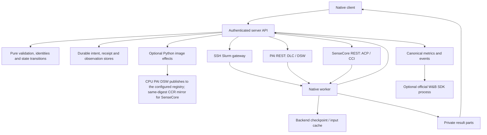

# Implementation and acceptance status

This release starts over from an empty registry, new data roots and freshly built
Runtime images ([clean start](operator-guide.md#clean-start)). **Provider acceptance
recorded against earlier releases is not evidence for this release.** The results
named below say which paths were once exercised and so what to test first; none has
been repeated on this release, and each must be before it is relied on. See the
[latest release](https://github.com/NotDesigned/ml-experiment-control/releases/latest)
for the current version.

Run status and Submission GETs read retained evidence; they do not contact the
provider. The optional background observer and explicit `run reconcile` refresh
the original cloud job. A concurrent cloud observation may temporarily return
HTTP 503 `CLOUD_RUN_BUSY`: repeat the same query, without submitting another job.
Lock contention is not a frozen-identity failure. Scheduler observation times
remain unknown where the retained record has no timestamp; PAI image-pull events
are not yet included in the cached Run summary.

The reported `training=INCOMPLETE` describes remaining acceptance work, not an
unfinished file transfer. Slurm GPU training/restore and SenseCore GPU acceptance
were never proven on any release. PAI CPU/H200 and W&B cloud acceptance passed only
in bounded tests on earlier releases. None of this establishes large-model or
all-backend acceptance.

“Connected” below means the CLI/API/service/worker code exists. It does not mean an
actual provider run has passed.

## Architecture

Package ownership and module boundaries are in [architecture](architecture.md). The
core reads no environment, clock, files or network; effects return explicit receipts
to it. Image build and copy wrappers are Python. W&B uses the official SDK process.
Research code may use Python/PyTorch or another image language.

## Connected workflows

| Workflow | Main implementation | Verification boundary |
| --- | --- | --- |
| Configure client, inspect status/logs/metrics, watch exact Attempt | `client/{config,session,watch,main}.rs` | Local HTTP and binary tests |
| Register approved Project; upload immutable source | `server/{projects,sources}`, `client/{projects,sources}.rs` | Private temporary stores and HTTP |
| Dockerfile prepare/build/reconcile/log/progress | `core/cloud/build.rs`, `server/cloud_runs/service/builds.rs`, `builds/native_image.py` | Frozen recipe and late-publication bridge tests; isolated DSW-to-Tokyo build passed |
| OCI-to-SIF on Slurm gateway | `worker/materialize.rs` | Exact reuse/capacity/tampering checks; real private ACR-to-SIF conversion passed |
| Upload/download cloud datasets | `server/objects.rs`, `service/datasets.rs`, `client/datasets.rs` | Bounded parts and immutable receipts; two-part OSS transfer/PAI CPU consumption and Slurm shared-storage upload/reuse passed |
| Import existing approved OSS datasets | `core/datasets/oss.rs`, `service/oss_import.rs`, `client/datasets.rs` | Scope-bound plain-tar inspection, immutable part reuse, no API-host spool; real OSS import and PAI CPU consumption passed |
| Download into CPFS / NAS input cache | `worker/{data_import,cloud_data}.rs` | Import/hash/cache tests; personal CPFS consumption passed; NAS provider acceptance pending |
| Frozen download script and verified persistent input cache | `core/data_preparation.rs`, `worker/data_preparation.rs`, `service/script_preparation.rs` | CPFS script execution and verified reuse passed; three-backend dispatch acceptance pending |
| CCR data image and CPU ACP copy before training | `service/data_delivery.rs`, `builds/native_data.py`, `worker/data_copy_cli.rs` | Stage control/hash/capability tests; actual copy pending |
| One experiment configuration | `core/preparation.rs`, `client/preparations.rs`, `service/preparations.rs` | Recovery slot, conflict, early preflight and HTTP tests |
| Matrix preparation and bounded dispatch | `core/preparation.rs`, `client/batch.rs` | Stable identities, exact terminal slot accounting; actual batch pending |
| Slurm / DLC / ACP submit, reconcile, refresh and cancel | `server/submissions`, `server/backends`, `server/cloud_runs` | Real bounded DLC CPU/H200 execution passed; Slurm GPU/ACP acceptance pending |
| Logs/history/checkpoints over gateway or scoped HTTPS | `io/observations.rs`, `worker/cloud_exchange.rs`, `service/exchange.rs` | Lost ACK, sequence, variant and frozen identity tests |
| Explicit new Attempt from selected persistent checkpoint | `core/cloud/retry.rs`, `service/retry.rs` | Immutable restore and budget checks; real PAI CPU and H200 split/continuous states matched independent oracles exactly |
| CPU result collection, direct download, verified ACK/release | `worker/cloud_artifacts.rs`, `service/artifacts.rs`, `client/artifacts.rs` | Real PAI zero-GPU synchronization, verified downloads, release and exact repeat passed |
| List and select result archive files | `client/artifacts/files.rs`, `io/artifacts.rs` | Selected-file persistence only after full archive verification; no partial ACK; direct original-file recovery still pending |
| DSW / CCI debug lifecycle | `core/cloud/debug.rs`, `service/debug.rs`, `client/debug.rs` | Actual zero-GPU DSW create/SSH/CPFS/stop/delete passed; CCI acceptance pending |
| Backend catalogue/cached capacity | `core/capacity.rs`, `service/capacity.rs`, `capacity_http.rs` | Local GET is effect-free; real PAI quota refresh and retained timestamp accepted; Slurm cached capacity refresh passed; SenseCore pending |
| Optional W&B publication | `core/tracking`, `server/tracking` | Fake SDK and durable ACK tests; same-Run official-cloud CPU acceptance passed; uncertain sends reserved pending remote proof |
| Scoped administrative maintenance and record retirement | `core/maintenance.rs`, `server/administration.rs`, `worker/maintenance.rs` | Confined plans and worker receipts; actual provider cleanup pending |
| Standalone verified client update | `core/distribution.rs`, `client/update.rs` | Public assets verified; public installer and update check passed on Tokyo |

Paths in the table are relative to `rust/crates`, except the two image bridge
paths under `server/src/ml_exp_server`. See [the native usage guide](../rust/README.md)
for commands and configuration shapes.

In the table, "passed" means passed on an earlier release. The build and SIF rows
were tests that published through one ACR registry. Builds now default to a CPU PAI
DSW publishing to a configured registry such as Docker Hub (see [builds](builds.md)).

SenseCore can select the compatible cluster with the highest SPOT allowance from an
operator allowlist when creating a new Run; the profile is then frozen, and
reconcile, cancel and explicit retry never select a different pool. Training pools
exclude debug; data-copy profiles explicitly use debug CPU pools. Quota observations
do not establish the number of idle GPUs.

DSW debug recipes use the v4 contract: at most 27 ASCII letters, digits and
underscores, with the personal CPFS mount at `/mnt/ml-expd-personal` (also DSW's
managed `/mnt/workspace`); the DLC mount contract stays separate. An uncertain
creation is never replayed under a corrected recipe. A positively rejected HTTP 400
`ValidationError` on a new create is retained as a failed creation and does not
permanently consume an active-machine slot; transport failures and other uncertain
outcomes still require reconciliation. Errors retain only bounded, redacted provider
code, HTTP status, message and request ID. Debug status preserves the native provider
state: a failed instance reports `FAILED`, missing old observations report an unknown
terminal outcome rather than a successful stop, and queueing never advertises SSH as
ready. DSW stop sends an explicit empty JSON object, because its endpoint rejects an
empty body. Asynchronous deletion reports `DELETING` until provider absence is
confirmed. A retained `last_error` is historical evidence, not the latest state.

## Builder and worker contracts

After changing the worker or its bridge, updating a source checkout does not update
a wheel installed in another environment. Exercise an actual build through the
running daemon and reconcile its receipt to establish what the service loads.

Three-backend training acceptance remains a separate pending check. Contracts that
bound behavior:

- **Storage layout.** Fresh PAI/NAS workspaces need no manual Run or cache-parent
  directories; the mounted personal root must exist. Links, escaping paths and
  shared-writable descendants are refused without repair.
- **Requests and credentials.** PAI CPU Runs pass the shared request shape; Slurm GPU
  validation is unchanged. Native credentials require service ownership and mode
  0600/0400, and configuration failures name the stage without exposing values.
- **Builder transport.** A proven pre-send failure permits another explicit execute of
  the same Runtime; a partial write, lost reply or generic error stays uncertain
  and requires reconciliation. Missing and stale sockets, same-identity recovery and
  lost-reply refusal are exercised without provider effects.
- **Environment and discovery.** Per-Run `env` is frozen with the protocol across
  Slurm/DLC/ACP, and reserved platform variables are refused before effects. `data list`
  reads bounded local metadata only and separates uploaded archives from ready caches.
- **Data preparation.** `data_preparation` freezes script path, interpreter, arguments,
  timeout and optional expected hash; source/image and user environment bind its cache
  identity, and the receipt records the script and every output file's SHA256. Slurm
  prepares on the networked gateway before submission, SenseCore uses the debug CPU ACP
  adapter, and PAI prepares inside the DLC job. Only complete verified caches are reused;
  failed/incomplete executions keep bounded diagnostics and are not silently replayed.
- **Filesystem publication.** The tested personal CPFS mount rejects
  `renameat2(RENAME_NOREPLACE)` (errno 22). Regular files use an atomic hard-link
  fallback that still refuses existing targets; dataset slots use exclusive directory
  allocation and publish the verified receipt last. General directory moves still
  require native no-replace support and can remain unavailable on such a filesystem.
- **Interrupted effects.** A saved build start marker without a live build requires
  reconciliation; it is not reported as EXECUTING and cannot be dispatched twice.
  SenseCore preparation distinguishes a running copy, terminal failure, completed copy
  and uncertain submission, and a failed copy returns `DATA_PREPARATION_FAILED` without
  authorizing GPU training. Slurm releases its helper metadata lock before running a
  download script; cancellation reaches the script, and failure retains diagnostics
  without publishing a PREPARED submission or replaying it.

## Storage and transfer contracts

- Dataset/result parts are 16 MiB, numbered from zero. Part count, metadata and
  storage budgets remain bounded.
- The API keeps source/control metadata and receipts. Cloud payloads stream to
  approved OSS parts; Slurm payloads go to the shared gateway. The API does not
  retain full dataset or weight archives.
- Recovery states stay on backend persistent storage. A complete ready marker,
  generation contents and hashes bind each registered checkpoint.
- Training completion, result publication, verification and release are distinct.
  Result ACK follows full client verification and local fsync. A lost ACK is
  reconciled with the same saved identity and file.
- Administrative deletion is a separate explicit plan. It cannot impersonate a
  verified download or cause a removed result to be collected again.
- PAI dataset loading uses signed object URLs and a verified personal CPFS cache.
  This does not enable the provider's blocked native OSS filesystem mount.

Metrics preserve arbitrary names and explicit units; protocol, checkpoint and
variant are identity fields. Scientific aggregation and model selection remain
research-code responsibilities. The W&B display contract keeps metric names across
Runs, with protocol and data identities in provenance; upgrading does not rename or
replay W&B history.
See [metric display](wandb.md#curves-and-chosen-results).

Cloud status normalizes the retained provider job ID, backend, native state and
queue reason into the shared client summary. Missing observation times remain
unknown. A new native Attempt manifest is not a local GPU process receipt;
unobserved native results are reported as not observed. Scheduler refresh releases
the global authorship lock before provider reads while retaining the Run fence
and serialized outbox commit, so a slow query does not block worker ingress.

## Deployment and release implementation

`ml-expd-rs --config /private/server.json` selects independent backend and tracking
files. `--check` and `--initialize` use the same file:
stores are created together only after dependency validation, existing/partial
registries are refused, and neither command submits provider jobs. Local checks never
start the W&B SDK or infer network readiness.

Native bundles contain four standalone executables, exact byte/SHA metadata, the
client installer and service/configuration examples. The release worker is static
musl for training images; server and client binaries keep the documented glibc
baseline. The release workflow tests the exact binaries before packaging. A manual
run produces artifacts only; a stable native tag enables public publication.

## Deliberate limits and remaining acceptance

The registry carries its own marker. Normal startup and GET never
initialize or repair it. Do not initialize over existing state. Unknown submissions and uncertain W&B
sends remain reserved; a successful connection check never authorizes replay.

Campaign authoring is intentionally absent; a Run does not need a research
question or Campaign. Batch commands perform explicit passes, not an unattended
queue. An expired authorization gate blocks dispatch until an explicit `run renew`
creates a fresh PREPARED plan; renewal is idempotent, preserves the Run/Attempt and
budget, and refuses any possible prior execution. No automatic checkpoint selection
or unbounded restart exists. Native debug supports CCI create/stop and DSW
create/stop/delete. Slurm dataset export is outside the OSS-specific dataset download
command.

The W&B publisher compares its frozen config in Rust, permitting W&B's omission of
empty mapping fields while rejecting changed nonempty values, nulls, arrays and extra
keys. A failed comparison retains unconfirmed events and never replays training.

Next testing sequence: deterministic regressions → isolated client/server on CPU
DSW → actual storage/build/debug lifecycle → bounded training/restore/collection
on each enabled backend. Test failures keep their original evidence; missing or
ambiguous effects are reconciled under the original identity, never replayed with a
new token.

## Evidence

Local/DSW logs live in ignored `.ops` directories and are not release artifacts.
[The usage guide](../rust/README.md#build-and-verification) lists reproducible
format, lint, workspace-test, binary-smoke and bridge-test commands. Passing these
checks establishes development evidence, not real GPU or production acceptance.
