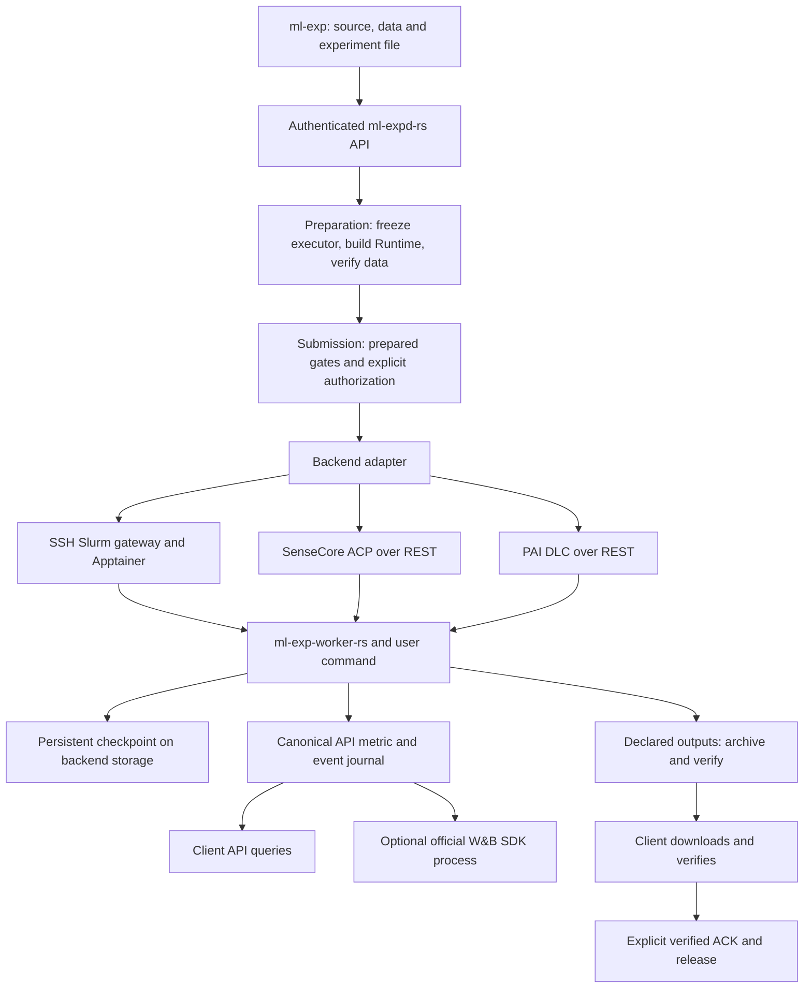

# Architecture and boundaries

ML-Expd runs a frozen experiment on a configured backend, records its progress,
and returns verified results. Experiment code defines the scientific computation,
metrics, checkpoint contents and model selection. The platform does not interpret
weights, choose hyperparameters or decide whether a scientific result is correct.

The default implementation is the Rust workspace in `rust/`. What has passed on
real providers is recorded separately in [acceptance status](rust-rewrite.md).

## Crates

| Crate | Source | Executables | Responsibility |
| --- | --- | --- | --- |
| `ml-exp-core` | `rust/crates/core/` | none | Pure identities, validation, budgets, state transitions, reconciliation decisions and request plans |
| `ml-exp-io` | `rust/crates/io/` | none | Confined files, hashing, bounded child processes, framing, archive and observation transport |
| `ml-exp-client` | `rust/crates/client/` | `ml-exp` | Private settings, packaging, saved recovery identities, observation and verified transfers |
| `ml-exp-server` | `rust/crates/server/` | `ml-expd-rs` | Authenticated API, durable ledgers, backend adapters and background observation |
| `ml-exp-worker` | `rust/crates/worker/` | `ml-exp-worker-rs` | In-image supervision, Slurm gateway helper, data verification, checkpoints and result collection |
| `experiment-redact` | `rust/src/` | `experiment-redact` | Shared credential redaction |

Core functions receive values and return decisions; they read no environment,
clock, files or network. Filesystem, network, clock, randomness and subprocess
effects belong to the outer crates, which return explicit receipts to the core.
The client has no Python dependency and needs no Docker, SSH or backend credentials.
Training images receive the static release worker, not the server environment.
User training code can use any language its image provides.

## Execution flow

The API freezes and orchestrates work; backend schedulers allocate resources.
Image builds run in a separate private builder (see
[the Python bridge](#python-bridge-boundary)), by default on a CPU PAI DSW that
publishes to a configured registry. DSW also supports temporary debugging; **DLC is
PAI's training backend**. SenseCore uses ACP for training and bounded data/result
copy jobs; CCI is a separate temporary debug-machine feature.

Cloud workers report process evidence, input progress, history pages and
checkpoint metadata over a scoped HTTPS exchange. Slurm collects equivalent
evidence through its gateway, so compute nodes need no internet.

A scheduler RUNNING state does not prove training has started. Process exit,
checkpoint registration, archive publication, client verification and W&B remote
confirmation remain separate evidence. Read-only status never starts a job or
repairs an uncertain operation automatically. Missing evidence remains unknown.

## Module map

Paths are relative to `rust/crates/`.

| Concern | Implementation |
| --- | --- |
| Client commands and transport | `client/src/main.rs` parses; `client/src/transport.rs`, `config.rs`, `credentials.rs`, `session.rs` connect |
| Client workflows | `client/src/preparations.rs`, `batch.rs`, `submissions.rs`, `runtime.rs`, `sources.rs`, `datasets.rs`, `artifacts.rs`, `debug.rs`, `administration.rs`, `update.rs` |
| Client observation | `client/src/observation.rs`, `status.rs`, `watch.rs`, `read.rs`, `presentation.rs`, `local.rs` |
| HTTP and daemon lifetime | `server/src/main.rs`, `lib.rs`, `deployment.rs`, `read_config.rs`, `readiness.rs`, `native_contract.rs` |
| Projects and immutable source | `core/src/projects.rs`, `core/src/sources.rs`, `server/src/projects/`, `server/src/sources/` |
| Preparation | `core/src/preparation.rs`, `core/src/first_submission/`, `server/src/preparation_http.rs`, `server/src/cloud_runs/service/preparations.rs`, `server/src/submissions/service/preparation.rs` |
| Slurm dispatch and control | `core/src/slurm/`, `server/src/backends/slurm/`, `server/src/submissions/`, `worker/src/slurm/` |
| Cloud dispatch and control | `core/src/cloud/`, `server/src/backends/cloud/`, `server/src/cloud_runs/` |
| Action storage | `server/src/operations/` |
| Data and capacity | `core/src/datasets/`, `core/src/data_preparation.rs`, `core/src/capacity.rs`, `server/src/objects.rs`, `server/src/capacity_http.rs`, `server/src/data_delivery_http.rs`, `worker/src/cloud_data.rs`, `worker/src/data_import.rs` |
| Images | `core/src/cloud/build.rs`, `core/src/cloud/materialize.rs`, `server/src/cloud_runs/service/builds.rs`, `worker/src/materialize.rs` |
| Results and retention | `core/src/artifacts/`, `io/src/artifacts.rs`, `server/src/submissions/artifact_http.rs`, `server/src/cloud_runs/service/artifacts.rs`, `worker/src/cloud_artifacts.rs` |
| Checkpoints | `core/src/checkpoints.rs`, `io/src/checkpoints.rs`, `server/src/checkpoints.rs` |
| Observation | `core/src/observation.rs`, `core/src/polling.rs`, `io/src/observations.rs`, `server/src/background.rs`, `server/src/read_api.rs`, `server/src/read_model.rs`, `worker/src/cloud_exchange.rs` |
| Platform metrics | `core/src/metrics.rs`, `core/src/records.rs`, `server/src/records/`, `server/src/local_http.rs` |
| W&B | `core/src/tracking/`, `server/src/tracking/` (the SDK process runs `server/src/tracking/sdk.py`) |
| Debug machines | `core/src/cloud/debug.rs`, `server/src/cloud_runs/debug_http.rs`, `server/src/cloud_runs/service/debug.rs`, `client/src/debug.rs` |
| Administrative maintenance | `core/src/maintenance.rs`, `server/src/administration.rs`, `server/src/deletion.rs`, `worker/src/maintenance.rs` |
| Historical reads | `server/src/history.rs`, `server/src/readonly.rs` |

Slurm and cloud are separate services behind one API. They share core types and
Action storage but have distinct adapters and effect stores. Adding a backend requires its
capability declaration, adapter and storage operations; there is no dynamic
plugin loader or second scheduler.

## Identities and storage

| Entity | Frozen meaning |
| --- | --- |
| Source | Immutable uploaded code tree |
| Runtime | Source, Dockerfile/build recipe, worker identity and published image |
| Asset | Archive/file hashes and explicit backend storage locations |
| Preparation | Original request, frozen executor and dependency identities |
| Run | Image, input data, command, resources and metric protocol |
| Attempt | One execution with its submission intent and exact backend identity |
| Action / Submission | Reviewed mutation, authorization, execution and recovery evidence |
| Checkpoint | Complete generation, file hashes and backend storage scope |
| Result receipt | Published archive and file hashes; download ACK is a separate record |

One registry root holds a daemon's control state. It carries a native marker
(`.rust-preview-workspace.json`), so a native daemon cannot adopt an existing
Python registry and ordinary startup never creates one. Actions use transactional
SQLite under `actions/` ([storage notes](action-storage.md)). The canonical
records journal is `tracking/outbox.sqlite`; optional W&B cursors do not create
another copy of experiment history. File-backed resources use cross-process
locks, revision checks and atomic transitions.

The API keeps source, control metadata and receipts, not full dataset or weight
archives. Transfers use 16 MiB parts numbered from zero. Slurm payloads go to
shared storage through the gateway. SenseCore uses a CCR data image and a CPU copy
to NAS. PAI datasets stay in approved OSS and are verified into a personal CPFS
cache. Recovery state stays on backend persistent storage. Source, outputs,
checkpoints and journals have separate lifetimes. See [data](data.md),
[checkpoints](persistent-checkpoints.md) and
[retention](recovery.md#download-confirmation-and-server-storage).

## Python bridge boundary

The client, API, worker and state machines need no Python. Two optional effects
keep it, and neither is needed for basic API or client reads:

| Effect | Code | Boundary |
| --- | --- | --- |
| Image build and copy | `server/src/ml_exp_server/builds/` (`native_image.py`, `native_data.py`, `native_worker.py`), which also imports other modules of that package; it also needs `worker/src/ml_exp_worker/` and `src/experiment_control/` on its import path | Separate process behind a private socket. Rust owns recipes, frozen Runtime identity and durable dispatch intent |
| W&B publication | `rust/crates/server/src/tracking/sdk.py`, run with the configured interpreter and the official SDK | Effect shell only. Rust compares identities and advances cursors |

Neither is an install path for the client or API. Two short launchers embedded in
native jobs also use Python, inside the training image and only when those jobs
run: `core/src/cloud/materialize.py` (PAI data materialization) and
`server/src/cloud_runs/service/sync_diagnostic.py` (read-only diagnostics). Release
and CI scripts and the `deploy_native.py` upgrade tool are operator tooling. Tag
`v1.5.1` preserves the retired Python service.

## Compatibility and upgrades

Existing Run/Attempt/source identities, routes, immutable image references,
review digests, publication routes and saved client operation IDs remain frozen.
Historical metadata is attached read-only, with separate native write roots: old
Actions never become native execution authority, and historical compatibility is
not permission to create another job or rewrite a manifest. Unknown submissions
and uncertain W&B sends stay reserved and are reconciled under their original
identity, never replayed.

Capabilities are both server- and image-specific. A Runtime receipt freezes the
exact worker's declared features, so updating the API cannot add features to an
immutable old image. New builds obtain current workers; old Attempts keep their
original dispatch behavior and command contract. READY Runtime receipts keep
their published identity. A not-yet-published Runtime whose frozen recipe differs
from the installed builder may need fresh preparation; inspect diagnostics and
reconcile effects first. Do not mutate that record, reuse an old confirmation or
replay an uncertain build.

The HTTP protocol is negotiated independently of the package version; see the
[HTTP contract](http_contract.md). An upgrade does not imply database restoration,
automatic rollback, resource cleanup or a GPU run. Operators follow the
[operator guide](operator-guide.md).
