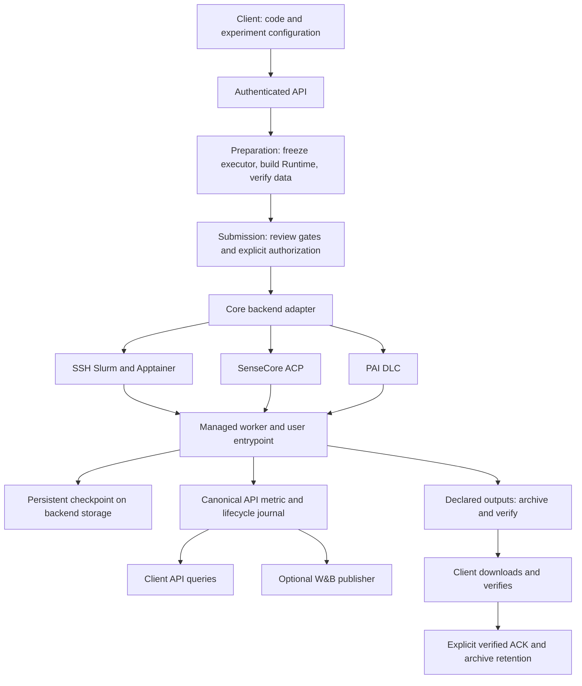

# Architecture and boundaries

ML-Expd runs a frozen experiment on a configured backend, records its progress,
and returns verified results. Experiment code defines the scientific computation,
metrics, checkpoint contents and model selection. The platform does not interpret
weights, choose hyperparameters or decide whether a scientific result is correct.

## Four packages

| Distribution | Source | Responsibility and dependencies |
| --- | --- | --- |
| `ml-experiment-client` | `client/src/ml_exp_client/` | HTTP SDK, `ml-exp`, packaging, saved operation state and verified downloads; no runtime dependencies |
| `ml-experiment-worker` | `worker/src/ml_exp_worker/` | 13 standard-library execution programs copied into backend jobs; no server/core/cloud SDK dependencies |
| `ml-experiment-control` | `src/experiment_control/` | Scheduler adapters, immutable manifests, submission identity and command runner; includes the Rust `experiment-redact` executable |
| `ml-experiment-server` | `server/src/ml_exp_server/` | API, preparation, storage, observation, checked mutations and optional publication; depends on core and worker |

The root `pyproject.toml` defines the core package and uv workspace. Client,
server and worker have separate package metadata. Client machines need only the
client. Training images receive fixed worker scripts, not the server environment.
The server's optional `[wandb]` extra publishes accepted records; metrics storage
and queries work without it. See [development](development.md) for installation
and independent coverage checks.

## Execution flow

The API freezes and orchestrates work; backend schedulers allocate resources.
A private image builder executes Docker publication locally, through SSH Docker,
or in an optional PAI CPU DSW. DSW also supports temporary debugging; **DLC is
PAI's training backend**. SenseCore uses ACP for training and bounded data/result
copy jobs; CCI is a separate temporary debug-machine feature.

A scheduler RUNNING state does not prove training has started. Process exit,
checkpoint registration, archive publication, client verification and W&B remote
confirmation remain separate evidence. Read-only status never starts a job or
repairs an uncertain operation automatically.

## Module map and actual entries

| Concern | Canonical implementation |
| --- | --- |
| Client transport and workflows | `client/api.py`, `workflow.py`, `operations.py`, `artifacts.py`, `state.py`; `cli.py` parses and prints |
| HTTP and daemon lifetime | `server/api/app.py`, `boundary.py`, `lifecycle.py`; `runtime.py` composes shared services |
| Projects and immutable source | `server/projects/` |
| Preparation and submission | `server/runs/experiment_preparation.py`, `first_submission.py`, `submissions.py`; `actions/` owns review, claims and reconciliation |
| Managed dispatch | `server/container_controller.py` calls core `backends/`; `controller_gateway.py` isolates reviewed external project controllers |
| Data and capacity | `server/data/`, including the server-only SSH `data_receiver.py`; `storage_capacity.py` provides shared admission |
| Images | `server/image_builder.py`, `dockerfile_build.py`, `worker_contract.py`, `builds/` |
| Results and retention | `server/results/`, `storage_service.py`, `local_retention.py` |
| Observation | `server/collectord.py`, `ingest/`, `runs/queries.py` and progress/evidence modules |
| Platform metrics | `server/records/contract.py`, `ingest.py`, `store.py`; `api/record_routes.py` accepts exact-Attempt uploads |
| W&B | `server/tracking/` and isolated `wandb_exporter.py` consume the accepted journal |
| Debug machines | `server/debug/`: models, lifecycle and CCI/DSW adapters |
| Administrative deletion | `server/runs/deletion.py`, `results/admin_deletion.py`, `backends/run_deletion.py` |

Paths in this table are relative to each package's `src/ml_exp_*` directory,
except the explicitly named client files. Core implementations live under
`src/experiment_control/`.

User and operator entries are `ml-exp`, `python -m ml_exp_client`, `ml-expd`, and
`ml-expd --config CONFIG doctor`. Service/frozen-controller entries also include
`python -m ml_exp_server.image_builder`, `container_controller` and
`wandb_exporter`. These are specific process boundaries, not interchangeable
public workflows. The generated [redactor CLI](cli_reference.md) is separate.

Core `backends/` owns availability, preflight, staging, submit/status/logs/cancel.
Server `backends/` owns shared-storage data preparation and result recovery.
They are different responsibilities. A small explicit mapping wires installed
providers; adding a backend requires its capability declaration, adapter and
server storage operations. There is no dynamic plugin loader or second scheduler.

## Identities and storage

| Entity | Frozen meaning |
| --- | --- |
| Source | Immutable uploaded code tree |
| Runtime | Source, Dockerfile/build recipe, worker identity and published image |
| Asset | Archive/file hashes and explicit backend storage locations |
| Preparation | Original request, frozen executor and dependency identities |
| Run | Image, input data, command, resources and metric protocol |
| Attempt | One execution with its submission intent and exact backend identity |
| Action / Submission | Reviewed mutation, authorization, execution and recovery evidence |
| Checkpoint | Complete generation, file hashes and backend storage scope |
| Result receipt | Published archive and file hashes; download ACK is a separate record |

Actions use transactional [SQLite storage](action-storage.md). File-backed
resources use cross-process locks, revision checks and atomic transitions.
The canonical records journal retains the historical `tracking/outbox.sqlite`
location; optional W&B cursors do not create another copy of experiment history.

Input transfers share a bounded 1 GiB part buffer, not a 1 GiB total-disk limit.
Slurm assets reside on shared storage; SenseCore uses CCR delivery to NAS; DLC
can retain originals in personal OSS and verified caches on CPFS. Source,
outputs, database recovery backups and journals have separate lifetimes.
See [data](data.md), [checkpoints](persistent-checkpoints.md) and
[retention](recovery.md#download-confirmation-and-server-storage).

## Compatibility and upgrades

Existing Run/Attempt/source identities, routes, immutable image references,
review digests, publication routes and saved client operation IDs remain frozen.
Legacy project parsing and historical desktop/object-store assets retain their
read paths. Generic Slurm replaces site-specific names for new configuration;
old storage records remain readable. Historical compatibility is not permission
to create another job or rewrite a manifest.

The worker package split preserves all 13 program files byte for byte, their
container destinations and the existing worker fingerprints. The resource helper
is not injected. Build recipes have their own fingerprint: moving imports can
change **new** bundle identities without changing the worker program bytes.
READY Runtime receipts keep their published identity. A not-yet-published Runtime
whose frozen recipe differs from the installed builder may require fresh Runtime
preparation; inspect its diagnostics and reconcile effects first. Do not mutate
that old record, reuse an old confirmation or replay an uncertain build.

Capabilities are both server- and image-specific. Updating the API cannot add
telemetry, launcher or checkpoint features to an immutable old image. New builds
obtain current workers; old Attempts keep their original dispatch behavior.
The HTTP protocol remains independently negotiated; see [HTTP contract](http_contract.md).

Upgrade acceptance preserves live state and private configuration. After acceptance,
remove inactive previous/candidate environments and disposable installation
copies; keep version/digest/CI reports and needed database recovery backups.
Never remove an environment still referenced by a process. An upgrade does not
imply database restoration, automatic rollback, resource cleanup or a GPU run.
