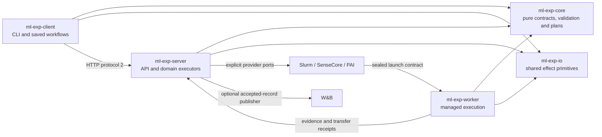

# Rust rewrite branch

`rewrite/rust` is an isolated development branch based on
`e725faec689fb8395e692e27d00a8896fa7fe5a5` (the deployed 1.5.1 source baseline).
The goal is a native Rust implementation of the platform: client, server,
provider integrations, builders, transfer helpers and workers. This is also an
opportunity to remove duplicate entry points and forwarding layers. The design
uses a functional core and a small imperative shell wherever practical.

**The rewrite is not complete, is not a replacement release and is not safe to
deploy over an existing workspace.** The Python implementation remains the
behavioral reference and the production implementation. No branch preview may
write production state, reuse provider mutation credentials, acknowledge a
research download or delete an existing asset.

User experiments are outside this language migration. A Run may still execute
Python, PyTorch, shell or any other code allowed by its image. The target is no
Python runtime dependency for platform binaries and their own helpers, not a
rewrite of users' training code.

## Complexity-first migration policy

The rewrite separates semantic risk from provider plumbing. Rust comes first for
identities, provenance, durable state, CAS/reconciliation, bounded streaming,
filesystem confinement, checkpoint/archive integrity and metric context. These
decisions can silently corrupt experiments or replay a submission when they are
wrong, so they are pure functions with explicit effect receipts.

Simple orchestration may remain Python during this phase: Dockerfile/image-build
wrappers, provider SDK calls, thin HTTP adapters, compatibility aliases and
presentation code. An image builder may stay Python while native Rust validates
its immutable digest, build receipt and retry decision. This avoids translating
forwarding code merely to make the language uniform.

## What exists now

| Component | Implemented foundation | Still missing |
| --- | --- | --- |
| Core | Frozen identities, Project schema/lifecycle and durable transitions, metric/journal decisions, source/archive and checkpoint identity/retention decisions, tracking plans, data-delivery and result-collection reducers, capability matcher, operation catalog, first-submission planner, input-progress parser, intent schema, Action/index reducers, Slurm/helper protocols, observation/failure projections | Remaining frozen contracts and complete cross-domain integration |
| Shared I/O | Private file/hash effects, directory capabilities, bounded child I/O, deadline-bound single-frame pipe transport and checkpoint generation verification/sealing | Remaining transport primitives and durable domain protocols |
| Client | URL-bound settings, bounded reads/watch, pure saved identity/status, Project commands and deterministic source archive upload/lookup | General asset/data transfers, artifact downloads/ACK, updates and full command coverage |
| Server | Approved discovery/reads, durable Project lifecycle, immutable source archive storage/receipts, native checkpoint registry and isolated journals; SQLite stores/Run fences; Slurm transport; pure data-delivery and result-collection decisions | Python effect shells still own artifact/result stores, submission/provider executors, collectors, TLS and tracking transport |
| Worker | Local process supervision, sealed local launch and scoped Slurm prepare/submit/inspect helper | Remote managed-launch transport, data/checkpoint/journal/artifact/build/copy/deletion protocols |

The native source path is deliberately Project-scoped: a shared tree digest does
not make one Project's metadata authoritative for another. Upload bodies are
bounded and streamed through a temporary file; the durable source store removes
the archive scratch file before publishing only the sealed tree and immutable
metadata. The native artifact core keeps the Python compatibility shape: receipt
file paths are internal names, while proof maps use `outputs/<path>`, and release
timestamps are explicit RFC3339 values. The object-store and provider shells are
still Python until their effect receipts have an equivalent native contract.

The checkpoint migration now spans the pure contract and local effect shell. A
ready marker is validated as one generation with bounded paths, file counts,
sizes and SHA256 values; the derived identity is bound to the exact
Project/Run/Attempt, source, image and storage scope. Descriptor-based
verification rejects links, special files, missing or extra files and changes
during hashing, then optionally seals the generation. The native server registry
stores immutable checkpoint receipts and makes duplicate registration idempotent
while rejecting a second manifest for the same generation. Worker HTTPS
registration, backend storage selection and process polling remain adapters.
The older completed-marker protocol used by legacy Slurm discovery remains a
separate compatibility path; it is not treated as a
`checkpoint.<sha256>` persistent-generation identity.

Submission intent and cancel-outbox decisions now have the same native boundary.
The Rust core validates the exact Project/Run/Attempt/backend identity, freezes a
bounded redacted request, derives a stable request digest and returns one of
Create, Reuse, Conflict or LegacyUnsafe. Provider adapters must report an exact
absence, an exact matching job, or an unavailable/ambiguous query; only the first
two can advance an intent, and only exact absence is retry-safe. Cancellation
publishes REQUESTED before the one permitted provider mutation, then requires an
exact terminal observation before marking it VERIFIED. Python still owns the
atomic JSON files, clocks, random token generation and provider calls. This keeps
the difficult replay boundary in a deterministic library without pretending the
Rust preview is a deployable scheduler.

W&B publication now has a matching pure reducer in
`ml-exp-core::tracking::publication`. It checks the exact sequence/event-ID
prefix returned by remote history, distinguishes an SDK send that is still
pending from a proven history ACK, and requires a separate display-version and
display-through ACK before terminal `finish`. The reducer returns only
`EmitHistory`, `PublishDisplay` and `Finish` actions; the Python shell retains
the SDK session, credentials, HTTP calls, durable outbox and retry timing.
Missing, stale or ambiguous remote history remains `ReconcileRequired`, so a
publisher timeout cannot create a duplicate row or falsely finish a Run.

The upload transfer buffer now has a native pure contract as well. Rust validates
the `upload.<sha256>`/part identity, derives the metadata filename and charged
filesystem bytes, applies the fixed one-GiB ceiling, checks durable remote
receipts, and reduces `RECEIVING → SEALED → CONFIRMED`. A confirmed part can be
reserved again only after its exact receipt has been proved. Python retains
fcntl locks, descriptor-safe files, streaming SHA256, run-deletion fences and
object-store calls; those effects consume the Rust decision rather than
reimplementing its safety rules.

Resumable multipart sessions now have a separate pure contract. Rust preserves
the Python upload ID byte format, validates policy and zero-based part sizes,
decides create/reuse/restart for immutable sessions, rejects replacement of a
sealed part, and checks the complete part set and whole-archive digest before
publication. Python continues to own staging directories, locks, streaming
`PartStream`, disk admission and the final object-store write.

The SenseCore data-delivery state machine now has a native contract in
`ml-exp-core::data_delivery`. It freezes the delivery definition and
confirmation, compares only the NAS identity when reusing a sealed `READY`
candidate, validates the data-image receipt and legal callback transitions, and
binds an ACP copy job to one exact scheduler name and UID. A
`RECONCILE_REQUIRED` record can be inspected or resumed, but its reducer never
authorizes a second ACP create. Durable JSON/journals, image construction,
SenseCore REST and ACP calls remain in the Python shell until a compatibility
facade is accepted.

Result recovery has the corresponding pure reducer in
`ml-exp-core::result_collection`. It keeps the original training Attempt
separate from bounded CPU/NAS collector retries, makes daemon interruption
explicit, requires exact provider-job observations, rejects ambiguous or
unavailable queries, detects conflicting unfinished archive identities, and
plans capacity-safe publication without reading files or deleting caches.
Archive streaming, storage reservations, locks, clocks and provider calls stay
outside the core. This is a foundation for replacing the Python decision logic;
it is not a claim that the production collector has already been switched.

The renderer-neutral operation catalog is now represented by
`ml-exp-core::operation_catalog`. It owns operation IDs, parameter metadata,
scope filtering and intent-kind validation in one immutable catalog. Action
authorization, availability reasons and execution remain separate concerns in
the Python server, so exposing a catalog cannot grant a scheduler mutation.

Backend matching now has a pure contract in `ml-exp-core::capabilities`. It
checks platform/materialization, data preparation, persistent storage,
observability, resource policy and worker capability requirements, then chooses
among configured candidates deterministically. The result explicitly says that
live availability was not checked; Slurm/ACP/PAI profile loading and live
capacity probes remain outside this reducer.

Input-delivery diagnostics now have a pure parser in
`ml-exp-core::input_progress`. It accepts only the bounded marker schema,
preserves the legacy failure marker, rejects invalid asset IDs and untrusted
field values, and leaves timestamp freshness to the shell that owns the log
read and clock. Log access, exact Attempt binding and outward rendering remain
Python effects.

First submission planning now has a pure contract in
`ml-exp-core::first_submission`. It validates the budget and `NOT_SUBMITTED`
gate, freezes the first Attempt and optional source binding, builds a structured
`SUBMIT_RUN` intent and derives the same deterministic idempotency key. The
server shell still reads Campaign files, checks the source service, serializes
the draft for the legacy API, persists the Action and performs authorization or
execution.

The preview client exposes `ml-exp-rs contract intent-validate` as a small
native bridge for this schema. The Python server can opt into it with
`ML_EXPD_CONTRACT_BIN`; when the binary is absent, the existing Pydantic path
continues to work. The bridge only validates and returns a receipt, so it
cannot authorize or execute an Action.

Metrics now include schema/definition validation, typed and wide observations,
explicit units, required/conditional metrics, context-sensitive conflicts and
`ratio_of_sums`. Variant, protocol, checkpoint, dataset, step and epoch remain
separate. Non-finite observations retain diagnostics. These pure functions do
not yet replace the production ingress or W&B publisher. The isolated native
journal accepts normalized records independently of tracking, retains immutable
routes and event order, and deduplicates content without losing event-ID bindings.
Its JSONL importer consumes bounded byte chunks and returns events plus new state;
only the shell persists those events. Raw record JSON refuses unpaired UTF-16
surrogates rather than silently replacing them. The separate frozen-identity
encoder supports their historical escaped representation.

Saved-state observation is also a value-in/value-out state machine: each step
returns an exact GET request or a completed identity, and consumes an explicit
response to advance. The small HTTP shell executes those GETs. It checks the
original server, Project, Run, nested Submission and Attempt; it never chooses a
new Attempt or retries a mutation. The preview CLI exposes `run status/logs/metrics` with either explicit identities
or the original private `--state` file. It validates the saved destination and
locally known identities before loading a token file or sending a handshake. A
saved state cannot choose a new destination for ambient API credentials.

The status library follows the same consumed-continuation pattern. Its output
keeps preparation, scheduler, training, publication and verification independent.
It preserves exact queue reasons and metric provenance, keeps missing timestamps
unknown, and handles unavailable collection/progress reads without inventing
success. These GET plans have synthetic differential and real loopback HTTP tests;
human summaries and logs/metrics commands are now connected to this path. Only
an observation without saved state may resolve the current Attempt once; saved
state without a bound Attempt never falls back to the current one. The watch loop pins the first observed Attempt and uses explicit elapsed time in
its pure reducer. Its shell cannot start another read after the observation
window; an in-flight HTTP read retains its own finite timeout. Historical native
status reads fetch exact Attempt evidence rather than borrowing the current
scheduler layer or interpreting a process state as scheduler evidence. Only the
separate opt-in tracking lifecycle exposes metadata POSTs; scheduler and research
asset mutations remain unavailable.

HTTP error bodies are capped at 16 KiB and sanitized before retention. The
existing native redactor is now a shared pure library with the original CLI
policy preserved. Diagnostic JSON additionally hides request fields, known secret
keys and credential echoes represented as numbers. Malformed/nonstandard JSON,
unpaired UTF-16 and non-ASCII Retry-After headers are conservatively discarded;
date headers support RFC 2822. This is an explicit stricter boundary, not a claim
that every Python error-string spelling has been reproduced.

Compatibility fixtures preserve the baseline source hashes and synthetic inputs.
Frozen JSON tests compare exact bytes and SHA256, including Python float formatting,
large integers and Unicode; observational projections also compare exact output
encoding. Action tests use a real legacy SQLite fixture, competing claims and
interrupted transactions. Slurm tests compare generated scripts and parse synthetic
scheduler evidence. None of these tests uses a live provider or production state.

The Action store keeps schema version 1 and immutable plan files. Pure reducers
take time, transition IDs and PID as input. Unknown submission outcomes remain
`RECONCILE_REQUIRED`; a retry plan requires exact, unambiguous evidence that no
job was submitted. Deletion guards never expire tombstones or delete assets.
Unix deletion storage retains directory descriptors rather than checking a path
and later reopening it. Intermediate symlinks, renamed/replaced parents and
non-regular lock targets are refused; new directory entries and immutable
tombstones are synced. Queries and index mutations share the deletion lock.
Action plan/command JSON and lock paths now use the same directory capabilities.
Ordinary operations require existing locks; they do not recreate a missing lock
or a deletion fence. Guard checks bracket blocking SQLite transactions and commit.

SQLite has a deliberately narrower guarantee. Its native VFS takes a pathname,
not the retained directory descriptor. The common boundary pins parent/file
identities, refuses symlinks, writable aliases and unsafe ownership, and checks
before and after work. It requires a service-private namespace owned by the
service account or trusted root; it cannot defeat arbitrary same-UID/root ABA
renames. Checks use directory-relative stat, without opening extra database or
WAL descriptors that could disrupt SQLite's POSIX locks. Newly created databases
are private; legacy journal modes are preserved. An error after a possible effect
reports uncertainty and requires reconciliation, not a claim that no write occurred.
The bundled SQLite is at least 3.51.3, which includes the upstream
[WAL-reset corruption fix](https://www.sqlite.org/wal.html#walresetbug).

Every ordinary journal read and mutation requires an explicit same-store Run
guard. Frozen configuration proves companion Run relationships; a name suffix
alone does not. Publication progress accepts a checked prefix of sequence/event
identities from a trusted publisher, not a free-form acknowledged integer. No
publisher network transport exists yet, and this internal evidence must never be
accepted directly from a worker or client. Confirming publication does not delete
experiment records or research files.

The disposable Run index preserves its legacy schema and unknown row metadata.
Pure change detection ignores only `scanned_at`, collector errors stay isolated
per verb, and evidence merging requires an exact Project/Run/Attempt. It is not
the authoritative source for the outward read model. Pure failure assessment
requires exact Attempt binding, actual start/observation times and failed terminal
domain evidence; a producer classification or decision alone remains diagnostic.
It cannot authorize a retry or turn publication failure into training failure. Launch
validation similarly verifies the sealed manifest without fetching or executing it.

Authoritative metadata now has a separate read-only library. Trusted configuration
pins each Project file and allowed Run roots. Canonical discovery is the default
when explicit locators are absent. It rejects duplicate Run IDs even with the
same SHA, overlapping roots, aliases and unsupported partial layouts. A second
bounded scan checks bindings before returning. Legacy explicit locators remain
a trusted-operator mode; clients/indexes cannot choose arbitrary locations.
Project/Run/Attempt identities are read from the files and checked before return,
with existing deletion guards and retained directory capabilities. Missing locks,
corrupt canonical files and changed byte hashes are errors; there is no implicit
repair or fallback to an old copy after a canonical-file error. Discovery stops
at authoritative manifests without traversing Run payloads, and never chooses
current by directory order. The raw SHA256 identifies file
bytes; the limited compared provenance fields do not establish a complete frozen
scientific identity or authorize execution.

YAML syntax uses a mature parser with explicit byte, node and depth bounds. The
accepted subset preserves JSON-compatible metadata from the tested legacy files
and Python `safe_dump` output. Aliases, anchors, tags, duplicate/non-string keys,
multiple documents, raw NEL/line/paragraph separators and ambiguous YAML 1.1
plain scalars are refused; explicit quoted escapes remain data. JSON uses its
own strict decoder. This is not complete PyYAML compatibility; unsupported legacy
syntax is refused rather than silently reinterpreted. Outward metadata passes
redaction; known authentication-secret echoes make the response fail closed.
Scientific metric names, units and values retain their meaning.

Source archive publication is the first native transfer subchain. The client
packs an approved local directory into bounded deterministic tar/gzip bytes and
sends one request with a fixed archive SHA and length. The server receives only
after an approved Project check, decodes with explicit archive/expanded/file
limits, rejects links, devices, protected paths and duplicate entries, seals the
tree, computes the same length-framed tree digest and publishes immutable
`source.json` plus an archive-SHA receipt. A lost POST response is reconciled
through a read-only receipt lookup; the client never automatically replays the
upload. Git import, automatic Project creation and patch proposals remain
Python/unported for now.

The preview can now expose configured local reads over authenticated protocol-2
HTTP: project listing, Run/current summary, Attempt listing, exact Attempt show,
logs, metrics and collection observations. `--initialize-registry` creates only
a fresh isolated namespace with a Rust-preview marker and deletion fence;
existing targets are refused. `--read-config` requires that marker and existing
locks. Read requests supply identities, never filesystem locations. Normal startup
and GET requests do not create, repair, collect, refresh providers or migrate state.
Discovery is unique only across the operator-approved roots, not machine-wide.
It defaults to depth16/4096 directories/100,000 entries/4096 Runs/32MiB metadata;
budget exhaustion is an explicit error rather than a partial list.

Optional Project lifecycle uses a distinct explicit initialization and startup
flag. Its pure reducers receive validated paths, time, revision and transition ID;
the shell validates approved file evidence, serializes the existing ledger lock,
publishes the head and appends its audit transition. Name-to-source-path identity
is frozen; Project YAML content remains refreshable. Restart never bootstraps a
removed record. Pause/archive/unregister do not require an available research
file, while registration/resume require fresh approved schema/identity evidence.
Lifecycle registration currently requires an empty `campaigns` list; Campaign file
loading and referenced revision binding are not yet available.

The durable head stores its full last transition. An explicit valid mutation can
finish that missing final journal entry or discard a syntactically truncated EOF
tail. Complete malformed/duplicate/foreign history is rejected. Read-only calls
report pending audit state without changing bytes. CAS and proposal/budget
validation precede repair. Any failure after possible effects is uncertain, including
timeouts and lost responses; no POST is automatically replayed. These are tracking
records, not job control or source upload. The initial indexing response explicitly
reports `NOT_IMPLEMENTED` rather than pretending a collector ran.

A snapshot budgets 32 MiB for Run/Attempt/evidence samples across at most 256
Attempts, plus a Project manifest and bounded frozen-file revalidation. Each
individual manifest is capped at 4 MiB.
Project listing uses metadata-only snapshots. Only the explicitly bound current
Attempt, or the requested exact Attempt in a detailed read, loads
up to 1 MiB and 10,000 lines per stdout/stderr/metric source. Sources are fixed
relative names under that Attempt; file paths in metadata cannot redirect reads.
Logs preserve Python text line separators; JSONL retains LF record framing.
Missing evidence, unreadable/malformed evidence and unloaded historical tails are
distinct. No explicit valid current mirror means current is unknown.

The read model separates scheduler, training, publication and verification.
It explicitly treats `PREEMPTED` as terminal, matching the core Run state model;
this corrects the old RunIndexRow flag rather than promising field-for-field
compatibility with that disposable row.
Collection is an observation of process evidence, **not** a migrated ArtifactStore:
it never asserts verified publication or download availability from collection
JSON alone. There is no artifact download, collection action or receipt ACK API.
Metric validation precedes filtering/downsampling. Truncated or damaged raw
history reports `PARTIAL` coverage; a canonical journal exceeding 8 MiB or
100,000 observations is refused instead of validating only a convenient suffix.
Journal reads also check workspace identity and frozen Run configuration binding.
A claimed normalized observation is checked again for canonical shape and valid
metric semantics before display. Malformed internal `VALID` records are refused;
legitimate failure/undeclared/conflict diagnostics remain unchanged. This is an
explicit stricter read boundary than the legacy trusted-normalized shortcut.
Responses and in-memory aggregation are bounded to 8 MiB. Four local operations may run concurrently, and
HTTP waiting ends after 30 seconds; this does not cancel blocking kernel/file I/O,
whose concurrency permit stays held until it finishes.

Temporary-file, actual Python differential, real TCP native-client tests and a
three-binary smoke test without Python cover this configured read path. They do
not establish production storage layout,
provider freshness, download safety or full experiment-platform acceptance.

The local `managed-launch` entry binds a private staged manifest, its exact HTTPS
identity/digest, approved workdir and an existing Attempt generation. It accepts no
command override. The pure launch validator verifies canonical bytes; the effect
shell fsyncs a durable STARTED marker before spawning, clears ambient environment,
supervises the process, and publishes a checked receipt. Repeated FINISHED reads
return that receipt; STARTED without a valid receipt remains uncertain and never
replays. Unsupported managed data/checkpoint/journal/publication capabilities are
refused before initialization/dispatch. Training completion is separate from
publication, which remains `NOT_IMPLEMENTED` and not downloadable.

This is a local staged subchain, not a cloud worker replacement or global
exactly-once service. Destroying and recreating the whole Attempt generation is
outside its retained identity guarantee. Same-UID/root adversarial pathname ABA,
host failure recovery and cgroup isolation still need separate designs/acceptance.
The preview has no remote manifest fetch or image entrypoint integration.

Several native policies deliberately reject unsafe legacy inputs: foreign or
duplicate Slurm identities, backwards terminal-state observations, malformed lock
targets and permission errors on deletion fences. Such validation changes are
recorded explicitly; they are not silent changes to old frozen identities.

No Rust module has been installed as a replacement for production. A passing
domain test is evidence for that tested domain, not acceptance of the entire
platform, an HTTP operation, or GPU training.

The preview commands are `ml-exp-rs`, `ml-expd-rs` and `ml-exp-worker-rs`.
They deliberately do not replace `ml-exp`, `ml-expd`, installed service units or
frozen worker image entries. See the [native development instructions](../rust/README.md).

## Isolated Slurm helper and tracking plans

Native Slurm control messages bind the configured backend/profile/storage scope,
Project/Run/Attempt, submission token and frozen manifest/script hashes. The server
executes one fixed SSH command with explicit configuration, host-key checks and
bounded stdin/stdout/stderr. Lost, truncated, foreign or timed-out replies remain
uncertain; the transport never retries automatically.

The worker's separate `slurm-helper --config /private/config.json --stdio` entry
implements prepare, submit and inspect. Initialization is explicit and separate.
A required root registry records the scope before creating its claim; an immutable
start marker is synced before invoking `sbatch`. A missing claim cannot become a
fresh submission. The helper rechecks its required registry and retained directory
bindings before dispatch, after the child exits and before returning success.
Name/comment are fixed command-line arguments, which Slurm documents as taking
precedence over script and environment options. See the
[sbatch input-environment rules](https://slurm.schedmd.com/sbatch.html#SECTION_INPUT-ENVIRONMENT-VARIABLES).
The initial helper refuses SBATCH overrides and SLURM cluster/config environment
variables; non-system Slurm configuration needs a separately bound configuration
extension before real deployment.

Every helper response has `safe_to_retry=false`, including PREPARED. An older
Submit may still be in transit; observing no start marker does not revoke it.
SUBMITTED means a durable job-ID receipt, not verified scheduler ownership.
Local tests use real Rust processes, fake SSH/sbatch and temporary state, including
lost replies, concurrency and missing metadata. Runtime/SIF preparation, shared
data, native ownership observation, Action dispatch and actual cluster acceptance
are not connected. The preview HTTP API still does not submit training.

Tracking is similarly split: pure options/routing and consuming display reducers
produce metric-definition and summary patches. They preserve variant, protocol,
unit, dataset and checkpoint provenance, explicit summaries, shadow curves and
bounded contexts. They use the same journal and existing display-name reservations;
there is no second W&B database. No SDK, HTTP publisher, remote ACK or live cloud
session is implemented by these plans.

## Five crates: functional core and imperative shell

| Crate | Owns | Must not own |
| --- | --- | --- |
| `ml-exp-core` | Immutable wire values, exact identities, validation, state reducers, metric schema, request planning, data-delivery/result-collection reducers and pure redaction | Files, network, environment reads, clocks, randomness, processes or scientific model selection |
| `ml-exp-io` | Shared bounded file/hash/atomic-write and effect primitives | Business state transitions, automatic retries or implicit provider policy |
| `ml-exp-client` | One command tree, connection/configuration, source packaging, resumable transfer, reviewed operations, observation and verified update | SSH/cloud credentials, a local scheduler or scientific completeness rules |
| `ml-exp-server` | Composition, HTTP, projects/sources, experiment/operation workflows, persistence, observation, data/build/result services, providers and optional tracking | Training computation or hidden replay of uncertain effects |
| `ml-exp-worker` | One native entry with explicit execution, prepare/copy, collection, build and scoped-deletion subcommands | Server modules, W&B credentials, arbitrary provider administration or implicit retries |

The existing `experiment-redact` is already Rust and remains the workspace's root
package. It is not a sixth new application layer. Its implementation should be
reused rather than replaced by another independent redaction policy.

Provider modules live together in the server, rather than being split between
an I/O-heavy core adapter and another server adapter. Each module implements the
ports it actually supports: scheduling, data/storage, resource observation and
optional debug sessions. A shared interface does not make unsupported operations
available. Slurm compute without Internet, SenseCore registry/NAS delivery and
PAI roles/CPFS remain different physical paths.

## Pure computation and explicit effects

Prefer pure functions for validation, state reduction, request planning,
compatibility checks, metric normalization and outward projections. Pass current
state, configuration, time, random identifiers and observed provider evidence as
explicit inputs. Return an immutable next state, a typed plan or `Result`; do not
read an environment variable or call a provider while deciding what should happen.

The imperative shell loads configuration, owns locks/leases, persists intents,
executes a reviewed plan and records the resulting evidence. Feed that evidence
back to pure reducers. Planning a submission must never submit it, and observing
a record must never repair an uncertain effect. File reads and hash streaming
belong to the I/O crate; hashing already-supplied bytes can remain pure.

Use ordinary functions, finite enums, structs and `Result`. Add a trait only at
a real replaceable boundary such as a provider or storage executor. One trait per
helper, deeply generic effect frameworks and extra thin forwarding modules would
make the rewrite harder to understand. Keep effect adapters small and test them
with real temporary files/processes or explicit transport fixtures as appropriate.

## Consolidation rules

- Keep one parser and one handler for each user operation. Existing public CLI
  names and saved states need explicit compatibility; private Python aliases,
  import facades and mixin forwarding do not need Rust equivalents.
- Compose services once. Merge `application`/`runtime`/controller facades where
  they only forward calls; keep a separate boundary where it owns authorization,
  persistence, admission, a subprocess or an external protocol.
- Use one reviewed mutation engine for prepare, authorize, execute and reconcile.
  Keep distinct typed effects and receipts for builds, data, submission,
  cancellation, collection and deletion. A common engine must not erase an
  effect's ownership, revision, confirmation or unknown-outcome rules.
- Keep one canonical record journal and one evidence reducer. W&B consumes
  accepted records; it is not another experiment database. Status, metrics,
  logs and progress reuse the same exact Run/Attempt binding.
- Keep one bounded transfer engine with destination adapters. Source, datasets,
  full recovery state and downloadable results retain separate identities and
  lifetimes. Sharing chunks does not imply identical deletion policy.
- Put historical `wyd` storage names, desktop asset locators, project-specific
  layouts and old controller invocation behind a named compatibility reader.
  New configuration uses generic Slurm and managed Runs. Do not create another
  provider branch for a historical name, or silently remove a still-supported
  read path.
- Python's public reusable-library API is a separate compatibility decision.
  A Rust crate cannot silently satisfy existing Python imports. Keep the old
  distribution until a documented consumer migration or approved bridge exists;
  a bridge is not completion of the all-Rust runtime goal.

## Inventory and progress accounting

The [machine-readable inventory](../rust/compatibility/inventory.json) records
all tracked Python files at the baseline, without scanning credentials or live
experiment state. Each platform module has its path, SHA256, line count, purpose,
top-level symbols, proposed target crate/domain and honest migration status.
The domain assignment is a consolidation plan, not a promise of one new Rust
file per old module.

| Baseline production package | Modules | Lines |
| --- | ---: | ---: |
| Core | 25 | 5,122 |
| Client | 21 | 3,712 |
| Server | 160 | 30,572 |
| Worker | 14 | 1,953 |
| Total | 220 | 41,359 |

The inventory separately covers 238 test/tool/example Python files, including
private builder/relay deployment helpers distributed as examples. Those helpers
must also lose their platform Python dependency before the goal is complete.
A scientific example payload may remain Python. Tests and packaging checks stay
until equivalent native acceptance exists; deleting them is not migration.

`partial_foundation` means a limited implementation exists with incomplete
contract acceptance. `not_started` means the target is only assigned. Neither
means production compatibility, and module counts are not a completion percentage.
The current inventory has 67 partial foundations out of 458 tracked Python
files (13.5% with some native foundation); no Python platform module is marked
fully replaced. The two newest foundations are the SenseCore data-delivery
contract and the exact-Attempt result-collection reducer. This percentage is a
scope indicator, not a claim that 13.5% of the production system can already be
cut over.

## Migration sequence and acceptance

Every stage first passes isolated native tests, then differential checks against
synthetic Python-baseline fixtures. Capture canonical bytes/digests and actual
side effects; equal JSON shapes alone do not prove identity compatibility.
Do not use production scientific payloads for mutation tests.

| Stage | Required behavior and evidence |
| --- | --- |
| 1. Contracts and durable state | Frozen Run/Attempt/source/Runtime/asset identities; byte-compatible canonical hashes; schema/protocol values; Action SQLite transactions; atomic files, locks, revisions, journal recovery and workspace ownership |
| 2. Read-only client/API | Full protocol-2 auth/negotiation/errors, exact status/logs/metrics, freshness/provenance, queue blockers, SSE resync, private config and saved-state observation; no provider mutation from GET |
| 3. Local managed lifecycle | Sealed launch, bounded process trees/timeouts/cancellation, separate training/publication outcomes, generic metric schema/requirements/conflicts, journals and exact capability claims |
| 4. Images and input data | Dockerfile validation, native builder RPC/peer credentials, OCI/Docker/BuildKit, DSW builder cleanup, ACR fallback intent and late publication, digest-preserving CCR mirror, source sealing, bounded multipart and durable destination ACK |
| 5. Slurm | SSH staging/locking, `sinfo`/`squeue`/`sacct` parsing, exact submission comment, cancellation outbox, Apptainer conversion, gateway relay and offline compute, shared dataset/checkpoint paths and result recovery |
| 6. SenseCore | Native ACP/CCI REST auth, pagination and exact resource ownership, highest eligible SPOT allowance excluding debug for GPU training, debug CPU copy/collection, CCR/NAS readiness, delayed offline stderr/events, bounded CCI create/status/stop |
| 7. PAI | Signed DLC/DSW/quota requests, private role/personal CPFS scope, native queue blockers, tide/priority/resource policy, DLC 24-hour cap and DSW 4-hour cap, OSS dataset/archive flows; native OSS mounts remain disabled while provider-blocked |
| 8. Checkpoints and outputs | Complete-generation checks and scoped explicit restore; no automatic checkpoint choice; recover existing outputs without training; archive/file completeness, SHA validation, partial/lost-reply resume, ACK and retention, signed/direct downloads |
| 9. Tracking and administration | Native optional W&B publication, per-Run destinations, preparation switch, curves vs chosen summaries, variant/unit/protocol separation, remote ACK and session liveness; bounded debug leases, reviewed deletion/fences and source/project lifecycle |
| 10. Distribution and cutover | Full user command tree, verified update, server doctor/config, native binaries for supported platforms, offline installs, reproducible release manifest/SHA, systemd/builder/relay entries, real provider validation and guarded deployment |

Slurm, SenseCore and PAI require independent real acceptance: scheduling success
is not training success, and training success is not verified download. Each must
exercise data delivery, training metrics, complete checkpoint restore and result
retrieval, plus queue/failure/unknown-effect cases. Use separately authorized bounded
resources for billable provider tests. No real-provider acceptance is claimed
for the current preview.

## External compatibility checklist

The rewrite is not done until every applicable boundary below is represented in
fixtures and real integration evidence. An unavailable native dependency or
undocumented wire behavior is a blocker, not permission to invoke Python under
a Rust wrapper.

| Boundary | Required preservation |
| --- | --- |
| Public HTTP / SSE | Protocol 2, bearer and scoped callbacks, prefix/TLS behavior, advertised capabilities, routes/status codes/errors, async state, invalidations and bounded streams |
| Local state | JSON/YAML field semantics, immutable hash inputs, client state/dispatch markers, SQLite schema/journal and Action revisions, file modes, no-follow reads, locks/fsync and migration decisions |
| SSH / Slurm / Apptainer | Exact scheduler identity, shell/argv quoting, upload/receiver protocol, shared scope, OCI-to-SIF identity, private TLS relay and sanitized observations |
| SenseCore | ACP/CCI REST, cluster/workspace binding, registry authentication, job/event/offline logs, exact names, zero-GPU copy/collection and NAS receipt scope |
| Alibaba PAI | Signed OpenAPI and credential chain, DLC/DSW/quota APIs, MCP builder upload/exec, roles, mounts, shutdown timers and original configured limits |
| Object / registry / Docker | S3-compatible result storage, OSS multipart/ranged/signed requests, OCI Registry v2 auth/digests, Docker Engine/BuildKit, Unix peer identity and private builder RPC |
| Git / ACR / release | Exact private context/tag intent, no tag overwrite or unknown replay, registry publication observation, GitHub release metadata, asset SHA and standalone update/install formats |
| Worker | Launch manifest, environment/path contract, worker fingerprints, data/metrics/checkpoint/result/deletion receipts and exact-Attempt callbacks; old immutable workers remain distinguishable |
| W&B / telemetry | Native authenticated publish/remote confirmation, optional defaults and independent cursors, stable displayed keys and metadata, heartbeat; sanitized optional OTLP transport |
| Public library / distribution | Deliberate Python-consumer migration, native CLI/service entries, supported OS/architecture, offline installs and no hidden Python platform subprocess |

W&B currently relies on its official Python SDK in the baseline. Native publishing
and remote-confirmation semantics need dedicated work and real-cloud verification;
a logging call that merely enqueues data is not sufficient. The same applies to
Alibaba signing/MCP and SDK-mediated object-store behavior. Preserve the current
implementation as a reference until native replacements are accepted.

## Deployment boundary

This branch must not run against the live writable workspace or replace a
published package's bytes. Preview tests use temporary state and loopback-only
services. A future cutover needs a separately reviewed release, all domain gates,
identity-preservation proof, idle checks, a clearly bounded state migration and
formal installed-client/provider acceptance. Only then may public executable
names and production service entries switch to the native implementation.
