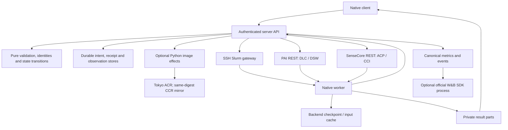

# Rust implementation and acceptance status

Development branch: `rewrite/rust`. Python reference baseline:
`e725faec689fb8395e692e27d00a8896fa7fe5a5` (1.5.1). Production still uses Python
1.5.1; the Rust workspace is `0.1.0-dev.1`. The planned native release is 0.1.0.
There is no production replacement or provider acceptance claim in this document.

The implementation pass connects the main research workflows before the next
round of debugging and provider tests. “Connected” means the CLI/API/service/
worker code exists. It does not mean an actual provider run has passed or that
all historical Python state can be migrated.

## Architecture

| Package | Owns |
| --- | --- |
| `ml-exp-core` | Pure identity, validation, budgets, transitions, reconciliation and plans |
| `ml-exp-io` | Confined files, hashes, bounded processes, streaming and sockets |
| `ml-exp-client` | Private URL/token settings, commands, saved identities and verified transfers |
| `ml-exp-server` | HTTP, durable storage, provider effects and background observation |
| `ml-exp-worker` | Process supervision, Slurm helpers, inputs, checkpoints, metrics and outputs |
| `experiment-redact` | Shared credential redaction |

The core reads no environment, clock, files or network. Effects return explicit
receipts to the core. Image build/copy wrappers may remain Python, as permitted
by the complexity-first migration policy. W&B retains the official SDK process.
Research code may use Python/PyTorch or another image language.

## Connected workflows

| Workflow | Main implementation | Verification boundary |
| --- | --- | --- |
| Configure client, inspect status/logs/metrics, watch exact Attempt | `client/{config,session,watch,main}.rs` | Local HTTP and binary tests |
| Register approved Project; upload immutable source | `server/{projects,sources}`, `client/{projects,sources}.rs` | Private temporary stores and HTTP |
| Dockerfile prepare/build/reconcile/log/progress | `core/cloud/build.rs`, `server/cloud_runs/service/builds.rs`, `builds/native_image.py` | Frozen recipe and late-publication bridge tests; isolated DSW-to-Tokyo build passed |
| OCI-to-SIF on Slurm gateway | `worker/materialize.rs` | Fake apptainer; exact reuse/capacity/tampering checks |
| Upload/download cloud datasets | `server/objects.rs`, `service/datasets.rs`, `client/datasets.rs` | Bounded parts and immutable receipts; isolated two-part OSS upload passed; full training consumption pending |
| Download into CPFS / NAS input cache | `worker/{data_import,cloud_data}.rs` | Import/hash/cache tests; provider storage pending |
| Frozen download script and verified persistent input cache | `core/data_preparation.rs`, `worker/data_preparation.rs`, `service/script_preparation.rs` | CPFS script execution and verified reuse passed; three-backend dispatch acceptance pending |
| CCR data image and CPU ACP copy before training | `service/data_delivery.rs`, `builds/native_data.py`, `worker/data_copy_cli.rs` | Stage control/hash/capability tests; actual copy pending |
| One experiment configuration | `core/preparation.rs`, `client/preparations.rs`, `service/preparations.rs` | Recovery slot, conflict, early preflight and HTTP tests |
| Matrix preparation and bounded dispatch | `core/preparation.rs`, `client/batch.rs` | Stable identities, exact terminal slot accounting; actual batch pending |
| Slurm / DLC / ACP submit, reconcile, refresh and cancel | `server/submissions`, `server/backends`, `server/cloud_runs` | Local scheduler/HTTP fixtures; actual provider run pending |
| Logs/history/checkpoints over gateway or scoped HTTPS | `io/observations.rs`, `worker/cloud_exchange.rs`, `service/exchange.rs` | Lost ACK, sequence, variant and frozen identity tests |
| Explicit new Attempt from selected persistent checkpoint | `core/cloud/retry.rs`, `service/retry.rs` | Immutable restore and cumulative budget checks; actual restore pending |
| CPU result collection, direct download, verified ACK/release | `worker/cloud_artifacts.rs`, `service/artifacts.rs`, `client/artifacts.rs` | Archive/member integrity and durable cursor tests; provider collection pending |
| DSW / CCI debug lifecycle | `core/cloud/debug.rs`, `service/debug.rs`, `client/debug.rs` | Native compile/identity checks; actual machine lifecycle pending |
| Backend catalogue/cached capacity | `core/capacity.rs`, `service/capacity.rs`, `capacity_http.rs` | Local GET is effect-free; real PAI quota refresh and retained timestamp accepted; Slurm/SenseCore pending |
| Optional W&B publication | `core/tracking`, `server/tracking` | Fake SDK and durable history/display ACK tests; official-cloud acceptance pending |
| Scoped administrative maintenance and record retirement | `core/maintenance.rs`, `server/administration.rs`, `worker/maintenance.rs` | Confined plans and worker receipts; actual provider cleanup pending |
| Standalone verified client update | `core/distribution.rs`, `client/update.rs` | Manifest/version/hash logic; packager/installer and tag workflow connected; assets not yet published |

Paths in the table are relative to `rust/crates`, except the two image bridge
paths under `server/src/ml_exp_server`. See [the native usage guide](../rust/README.md)
for commands and configuration shapes.

SenseCore can select the compatible cluster with the highest SPOT allowance
from an operator allowlist when creating a new Run. The selected profile is then
frozen. Reconcile, cancel and explicit retry never select a different pool.
Training pools exclude debug; data-copy profiles explicitly use debug CPU pools.
Quota observations do not establish the number of idle GPUs.

## Latest implementation completion pass

Fresh PAI/NAS workspaces no longer need manual creation of platform-owned Run
and cache-parent directories when using a worker with `storage-layout.v1`.
The mounted personal root must exist. A pure frozen layout bounds the worker's
directory effects; links, escaping paths and shared-writable descendants are
refused without repair. New data-copy jobs use the same layout. Runtime receipts
freeze the exact worker's declared capabilities, so older images/Run identities
retain their original package and command contract.

PAI CPU Runs now pass the shared request shape instead of being rejected by a
Slurm-only positive-GPU constraint. Slurm GPU validation remains unchanged.
Private configuration failures identify the relevant credential or dependency
stage without exposing values. Native credentials require service ownership and
mode 0600/0400; original group-readable Python credentials remain unchanged.

The isolated native client/API and actual DSW-to-Tokyo image build have run.
Builder transport now records whether any request bytes may have been sent.
A proven pre-send failure permits another explicit execute of the same Runtime;
a partial write, lost reply or older generic error stays uncertain and requires
reconciliation. Missing and stale sockets, same-identity recovery and lost-reply
refusal are exercised without provider effects.

Full native CPU execution/restore/result acceptance, three-backend training and
production cutover remain separate pending checks.

The completion pass also connects per-Run `env` across Slurm/DLC/ACP and a
shared read-only `data list` path. Environment values are frozen with the protocol;
reserved platform variables are refused before effects. Dataset discovery reads
bounded local metadata only and separates uploaded archives from ready caches.
Neither addition changes the encoding of old requests that omit the new fields.

Optional `data_preparation` now freezes the script path, interpreter, arguments,
timeout and optional expected content hash. The source/image and user environment
bind its cache identity; the receipt records the actual script and every output
file's SHA256. Slurm prepares on the networked gateway before scheduler submission;
SenseCore uses the configured debug CPU ACP adapter; PAI prepares inside the DLC
job before training. Only complete verified caches are reused. Failed/incomplete
executions retain bounded logs and diagnostics and are not silently replayed.
The training `DATA_DIR` points to this cache; result packaging remains separate.

CPFS does not accept `renameat2(RENAME_NOREPLACE)` on the tested personal mount
(errno 22). Regular-file publication now has an atomic hard-link fallback that
still refuses existing targets. Dataset slots use exclusive directory allocation
and publish the final verified receipt last. They never use check-then-rename or
accept an incomplete directory as READY. General directory moves still require
native no-replace support and can remain unavailable on such a filesystem.
Startup publication failures identify the stage and errno without package tokens.

Build progress distinguishes a live build thread/held worker lock from a saved
start marker left by an interrupted process. The latter requires reconciliation;
it does not remain falsely EXECUTING and cannot be dispatched twice.

SenseCore preparation now distinguishes a running CPU copy, a terminal failure,
a completed copy and an uncertain submission. Preparation GET reads that retained
outbox evidence without contacting the provider or creating a copy. Failed CPU
preparation returns `DATA_PREPARATION_FAILED`; it never authorizes GPU training.
Slurm releases its global helper metadata lock after reserving the exact intent
and before running a download script. The original cancellation signal reaches
that script; cancellation/failure retains diagnostics without publishing a
PREPARED submission or replaying the script.

## Storage and transfer contracts

- Dataset/result parts are 16 MiB, numbered from zero. Part count, metadata and
  storage budgets remain bounded; the old 4 GiB payload ceiling is removed.
- The API keeps source/control metadata and receipts. Cloud payloads stream to
  approved OSS parts; Slurm payloads go to the shared gateway. The API does not
  retain full dataset or weight archives.
- Recovery states stay on backend persistent storage. A complete ready marker,
  generation contents and hashes bind each registered checkpoint.
- Training completion, result publication, verification and release are distinct.
  Result ACK follows full client verification and local fsync. A lost ACK is
  reconciled with the same saved identity and file.
- Administrative deletion is a separate explicit plan. It cannot impersonate a
  verified download or cause a removed result to be collected again.
- PAI dataset loading uses signed object URLs and a verified personal CPFS cache.
  This does not enable the provider's previously blocked native OSS filesystem mount.

Metrics preserve arbitrary names and explicit units; protocol, checkpoint and
variant are identity fields. Required metrics come from each Run's schema. Step
series and final summaries have distinct W&B projections. Scientific aggregation
and model selection remain research-code responsibilities.

## Deployment and release implementation

`ml-expd-rs --config /private/server.json` selects independent backend, tracking
and optional historical-reader files. All paths are absolute; initialization
remains explicit. The same file now supports local `--check` and fresh
`--initialize`: all selected stores are created together only after dependency
validation, existing/partial registries are refused, and neither command submits
provider jobs. Local checks never start the W&B SDK or infer network readiness.
Independent Slurm/PAI/SenseCore templates document private credentials and storage.
Native bundles contain four standalone executables, exact
byte/SHA metadata, the client installer and service/configuration examples.
The release worker is built with static musl linkage for training images;
server and client binaries retain the documented glibc baseline.
The release workflow tests the exact binaries before packaging. A manual run
produces artifacts only; a stable native tag enables public publication.
The native 0.1.0 tag and production cutover have not happened.

## Deliberate limits and remaining acceptance

The native registry uses a separate marker. Normal startup and GET never
initialize or repair it. Do not point the preview binary at production state.
Before cutover, historical Project/Run/Attempt identities, source/runtime hashes,
checkpoint reads, result tombstones and W&B cursors need migration acceptance.
The old working environment remains the sole production environment meanwhile.

Campaign authoring is intentionally absent; a Run does not need a research
question or Campaign. Batch commands perform explicit passes, not an unattended
queue. An expired authorization gate blocks dispatch until an explicit `run renew`
creates a fresh PREPARED plan. Renewal is idempotent, preserves the Run/Attempt
and budget, and refuses any possible prior execution. No automatic checkpoint selection or unbounded restart exists.
Native debug supports CCI create/stop and DSW create/stop/delete. Slurm dataset
export is outside the OSS-specific dataset download command.

An offline `ml-expd-state-audit` now fingerprints existing manifests, checkpoint
and result receipts, source/runtime/preparation control receipts, tombstones,
lifecycle records, Action plans and SQLite rows.
It compares metadata without initializing a native marker, making a database
copy or reading scientific payloads. It preserves metric receive order and
includes event IDs and W&B cursors; equality is not production cutover authority.
Historical-state transformation and provider acceptance remain separate work.

An explicit historical daemon mode now reuses the ordinary read projections
without initializing the original namespace. Offline configuration inspection
pins the original metric journal identity. Project lifecycle and deletion
records remain authoritative. Historical HTTP observations have mandatory
kernel write denial, no effect services, and all mutation/worker-ingress routes
are rejected. The same pinned reader can now attach to a writable native service. One address
routes reads by exact Run ownership, combines Project counters and reserves
all historical IDs against new authorship. Both Slurm and cloud creation paths,
including asynchronous preparations, share this reservation. Writable/native
and original roots must be disjoint. A new frozen Run can reference a historical
checkpoint only when the native storage scope and path convention match; old
Actions never become native execution authority. Historical W&B status reads
retain original routes and cursors without publishing.

Registered checkpoint GETs can also read historical Run/Attempt receipts without
a native Submission. They validate the original source/image and issued storage
context, preserve withdrawn/deleted scopes, and create no locks or seals. A
native-created Run never falls back to this reader if its native authority is
missing or corrupt. Reading a historical checkpoint does not authorize replaying
its old Action or automatically restarting a job.

Next testing sequence: deterministic regressions → isolated client/server on CPU
DSW → actual storage/build/debug lifecycle → bounded training/restore/collection
on each enabled backend → historical-state migration and guarded production
cutover. Test failures keep their original evidence; missing or ambiguous effects
are reconciled under the original identity, never replayed with a new token.

## Inventory and evidence

[The inventory](../rust/compatibility/inventory.json) retains every baseline
Python module and its original hash: 220 platform modules / 41,359 lines, plus
238 test/tool/example files. Baseline module parity and connected native
workflows are tracked separately. A zero count of fully accepted Python module
replacements is not an estimate of how much Rust code is written.

Local/DSW logs live in ignored `.ops` directories and are not release artifacts.
[The usage guide](../rust/README.md#build-and-verification) lists reproducible
format, lint, workspace-test, binary-smoke and bridge-test commands. Passing these
checks establishes development evidence, not real GPU or production acceptance.
