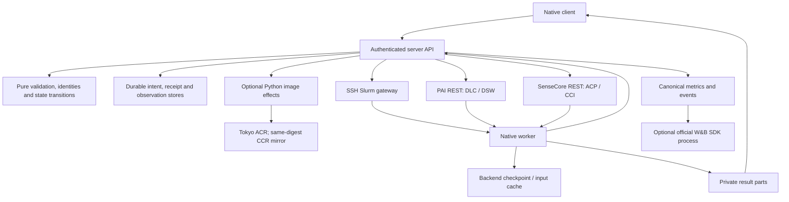

# Rust implementation and acceptance status

Development branch: `rewrite/rust`. Python reference baseline:
`e725faec689fb8395e692e27d00a8896fa7fe5a5` (1.5.1). Production runs the native
service on Tokyo; Python API/builder services on Seoul are retired. The native
workspace release is `native-v0.1.13`. Direct HTTPS uses
`https://server-tokyo.adscn.dev:2087/ml-expd`; the original API domain remains
available through its existing proxy. Historical metadata is attached read-only,
with separate native write namespaces. Slurm connects through the direct
L40S-to-Tokyo gateway.

`GET /api/actions/policy` now exposes native permission flags for older client
connection checks. It neither enables old Action mutation routes nor probes a
provider. The reported `training=INCOMPLETE` / `migration=IN_PROGRESS` describes
remaining acceptance and historical compatibility work, not an unfinished file
transfer: Slurm GPU training/restore and SenseCore GPU acceptance remain unproven,
and the full legacy metadata audit still has gaps. PAI CPU/H200 and W&B cloud
acceptance passed in bounded tests. These do not establish large-model or all-backend
acceptance. The older client's normal `check` can succeed; `check --training`
continues to fail closed.

The implementation pass connects the main research workflows before the next
round of debugging and provider tests. “Connected” means the CLI/API/service/
worker code exists. It does not mean an actual provider run has passed or that
all historical Python state can be migrated.

## Architecture

| Package | Owns |
| --- | --- |
| `ml-exp-core` | Pure identity, validation, budgets, transitions, reconciliation and plans |
| `ml-exp-io` | Confined files, hashes, bounded processes, streaming and sockets |
| `ml-exp-client` | Private URL/token settings, commands, saved identities and verified transfers |
| `ml-exp-server` | HTTP, durable storage, provider effects and background observation |
| `ml-exp-worker` | Process supervision, Slurm helpers, inputs, checkpoints, metrics and outputs |
| `experiment-redact` | Shared credential redaction |

The core reads no environment, clock, files or network. Effects return explicit
receipts to the core. Image build/copy wrappers may remain Python, as permitted
by the complexity-first migration policy. W&B retains the official SDK process.
Research code may use Python/PyTorch or another image language.

## Connected workflows

| Workflow | Main implementation | Verification boundary |
| --- | --- | --- |
| Configure client, inspect status/logs/metrics, watch exact Attempt | `client/{config,session,watch,main}.rs` | Local HTTP and binary tests |
| Register approved Project; upload immutable source | `server/{projects,sources}`, `client/{projects,sources}.rs` | Private temporary stores and HTTP |
| Dockerfile prepare/build/reconcile/log/progress | `core/cloud/build.rs`, `server/cloud_runs/service/builds.rs`, `builds/native_image.py` | Frozen recipe and late-publication bridge tests; isolated DSW-to-Tokyo build passed |
| OCI-to-SIF on Slurm gateway | `worker/materialize.rs` | Exact reuse/capacity/tampering checks; real private ACR-to-SIF conversion passed |
| Upload/download cloud datasets | `server/objects.rs`, `service/datasets.rs`, `client/datasets.rs` | Bounded parts and immutable receipts; two-part OSS transfer/PAI CPU consumption and Slurm shared-storage upload/reuse passed |
| Import existing approved OSS datasets | `core/datasets/oss.rs`, `service/oss_import.rs`, `client/datasets.rs` | Scope-bound plain-tar inspection, immutable part reuse, no API-host spool; real OSS import and PAI CPU consumption passed |
| Download into CPFS / NAS input cache | `worker/{data_import,cloud_data}.rs` | Import/hash/cache tests; personal CPFS consumption passed; NAS provider acceptance pending |
| Frozen download script and verified persistent input cache | `core/data_preparation.rs`, `worker/data_preparation.rs`, `service/script_preparation.rs` | CPFS script execution and verified reuse passed; three-backend dispatch acceptance pending |
| CCR data image and CPU ACP copy before training | `service/data_delivery.rs`, `builds/native_data.py`, `worker/data_copy_cli.rs` | Stage control/hash/capability tests; actual copy pending |
| One experiment configuration | `core/preparation.rs`, `client/preparations.rs`, `service/preparations.rs` | Recovery slot, conflict, early preflight and HTTP tests |
| Matrix preparation and bounded dispatch | `core/preparation.rs`, `client/batch.rs` | Stable identities, exact terminal slot accounting; actual batch pending |
| Slurm / DLC / ACP submit, reconcile, refresh and cancel | `server/submissions`, `server/backends`, `server/cloud_runs` | Real bounded DLC CPU/H200 execution passed; Slurm GPU/ACP acceptance pending |
| Logs/history/checkpoints over gateway or scoped HTTPS | `io/observations.rs`, `worker/cloud_exchange.rs`, `service/exchange.rs` | Lost ACK, sequence, variant and frozen identity tests |
| Explicit new Attempt from selected persistent checkpoint | `core/cloud/retry.rs`, `service/retry.rs` | Immutable restore and budget checks; real PAI CPU and H200 split/continuous states matched independent oracles exactly |
| CPU result collection, direct download, verified ACK/release | `worker/cloud_artifacts.rs`, `service/artifacts.rs`, `client/artifacts.rs` | Real PAI zero-GPU synchronization, verified downloads, release and exact repeat passed |
| List and select result archive files | `client/artifacts/files.rs`, `io/artifacts.rs` | Selected-file persistence only after full archive verification; no partial ACK; direct original-file recovery still pending |
| DSW / CCI debug lifecycle | `core/cloud/debug.rs`, `service/debug.rs`, `client/debug.rs` | Actual zero-GPU DSW create/SSH/CPFS/stop/delete passed; CCI acceptance pending |
| Backend catalogue/cached capacity | `core/capacity.rs`, `service/capacity.rs`, `capacity_http.rs` | Local GET is effect-free; real PAI quota refresh and retained timestamp accepted; Slurm cached capacity refresh passed; SenseCore pending |
| Optional W&B publication | `core/tracking`, `server/tracking` | Fake SDK and durable ACK tests; same-Run official-cloud CPU acceptance passed; historical handoff attached, uncertain sends reserved pending remote proof |
| Scoped administrative maintenance and record retirement | `core/maintenance.rs`, `server/administration.rs`, `worker/maintenance.rs` | Confined plans and worker receipts; actual provider cleanup pending |
| Standalone verified client update | `core/distribution.rs`, `client/update.rs` | Public assets verified; public installer and update check passed on Tokyo |

Paths in the table are relative to `rust/crates`, except the two image bridge
paths under `server/src/ml_exp_server`. See [the native usage guide](../rust/README.md)
for commands and configuration shapes.

SenseCore can select the compatible cluster with the highest SPOT allowance
from an operator allowlist when creating a new Run. The selected profile is then
frozen. Reconcile, cancel and explicit retry never select a different pool.
Training pools exclude debug; data-copy profiles explicitly use debug CPU pools.
Quota observations do not establish the number of idle GPUs.

New DSW debug recipes use the v4 contract: at most 27 ASCII letters,
digits and underscores. The explicit personal CPFS mount uses
`/mnt/ml-expd-personal`, which DSW also exposes as its managed `/mnt/workspace`.
The DLC mount contract stays separate. Previously issued v1/v2/v3 recipes retain
their exact original names, request bodies and lookup identities; an uncertain
creation is never replayed under a corrected recipe. A positively rejected HTTP 400
`ValidationError` on a new DSW create is retained as a failed creation and does
not permanently consume an active-machine slot. Transport failures and other
uncertain outcomes still require reconciliation. New creation errors retain
only bounded, redacted provider code, HTTP status, message and request ID;
credentials and arbitrary response documents are excluded.
Debug status preserves the native provider state. A failed instance reports
`FAILED`, and the latest matching DSW lifecycle failure reason is retained when
available. Missing old observations report an unknown terminal outcome rather
than a successful stop. Queueing never advertises an SSH connection as ready.
DSW stop sends an explicit empty JSON object; its REST endpoint rejects an empty
request body with `Bad request: EOF`. Debug mutation failures also retain the
operation and bounded provider response in `last_error`.
Asynchronous deletion reports `DELETING` and remains eligible for background
observation until provider absence is confirmed. A retained `last_error` is
historical evidence, not a replacement for the latest established state.

## Latest implementation completion pass

Fresh PAI/NAS workspaces no longer need manual creation of platform-owned Run
and cache-parent directories when using a worker with `storage-layout.v1`.
The mounted personal root must exist. A pure frozen layout bounds the worker's
directory effects; links, escaping paths and shared-writable descendants are
refused without repair. New data-copy jobs use the same layout. Runtime receipts
freeze the exact worker's declared capabilities, so older images/Run identities
retain their original package and command contract.

PAI CPU Runs now pass the shared request shape instead of being rejected by a
Slurm-only positive-GPU constraint. Slurm GPU validation remains unchanged.
Private configuration failures identify the relevant credential or dependency
stage without exposing values. Native credentials require service ownership and
mode 0600/0400; original group-readable Python credentials remain unchanged.

The isolated native client/API and actual DSW-to-Tokyo image build have run.
Builder transport now records whether any request bytes may have been sent.
A proven pre-send failure permits another explicit execute of the same Runtime;
a partial write, lost reply or older generic error stays uncertain and requires
reconciliation. Missing and stale sockets, same-identity recovery and lost-reply
refusal are exercised without provider effects.

Bounded native PAI CPU execution, restore and results passed on Tokyo.
Three-backend training acceptance remains a separate pending check.

The completion pass also connects per-Run `env` across Slurm/DLC/ACP and a
shared read-only `data list` path. Environment values are frozen with the protocol;
reserved platform variables are refused before effects. Dataset discovery reads
bounded local metadata only and separates uploaded archives from ready caches.
Neither addition changes the encoding of old requests that omit the new fields.

Optional `data_preparation` now freezes the script path, interpreter, arguments,
timeout and optional expected content hash. The source/image and user environment
bind its cache identity; the receipt records the actual script and every output
file's SHA256. Slurm prepares on the networked gateway before scheduler submission;
SenseCore uses the configured debug CPU ACP adapter; PAI prepares inside the DLC
job before training. Only complete verified caches are reused. Failed/incomplete
executions retain bounded logs and diagnostics and are not silently replayed.
The training `DATA_DIR` points to this cache; result packaging remains separate.

CPFS does not accept `renameat2(RENAME_NOREPLACE)` on the tested personal mount
(errno 22). Regular-file publication now has an atomic hard-link fallback that
still refuses existing targets. Dataset slots use exclusive directory allocation
and publish the final verified receipt last. They never use check-then-rename or
accept an incomplete directory as READY. General directory moves still require
native no-replace support and can remain unavailable on such a filesystem.
Startup publication failures identify the stage and errno without package tokens.

Build progress distinguishes a live build thread/held worker lock from a saved
start marker left by an interrupted process. The latter requires reconciliation;
it does not remain falsely EXECUTING and cannot be dispatched twice.

SenseCore preparation now distinguishes a running CPU copy, a terminal failure,
a completed copy and an uncertain submission. Preparation GET reads that retained
outbox evidence without contacting the provider or creating a copy. Failed CPU
preparation returns `DATA_PREPARATION_FAILED`; it never authorizes GPU training.
Slurm releases its global helper metadata lock after reserving the exact intent
and before running a download script. The original cancellation signal reaches
that script; cancellation/failure retains diagnostics without publishing a
PREPARED submission or replaying the script.

## Storage and transfer contracts

- Dataset/result parts are 16 MiB, numbered from zero. Part count, metadata and
  storage budgets remain bounded; the old 4 GiB payload ceiling is removed.
- The API keeps source/control metadata and receipts. Cloud payloads stream to
  approved OSS parts; Slurm payloads go to the shared gateway. The API does not
  retain full dataset or weight archives.
- Recovery states stay on backend persistent storage. A complete ready marker,
  generation contents and hashes bind each registered checkpoint.
- Training completion, result publication, verification and release are distinct.
  Result ACK follows full client verification and local fsync. A lost ACK is
  reconciled with the same saved identity and file.
- Administrative deletion is a separate explicit plan. It cannot impersonate a
  verified download or cause a removed result to be collected again.
- PAI dataset loading uses signed object URLs and a verified personal CPFS cache.
  This does not enable the provider's previously blocked native OSS filesystem mount.

Metrics preserve arbitrary names and explicit units; protocol, checkpoint and
variant are identity fields. Required metrics come from each Run's schema. Step
series and final summaries have distinct W&B projections. Scientific aggregation
and model selection remain research-code responsibilities.

Cloud status normalizes the retained provider job ID, backend, native state and
queue reason into the shared client summary. Missing observation times remain
unknown. A new native Attempt manifest is not a local GPU process receipt;
unobserved native results are reported as not observed. Scheduler refresh releases
the global authorship lock before provider reads while retaining the Run fence
and serialized outbox commit, so a slow query does not block worker ingress.

## Deployment and release implementation

`ml-expd-rs --config /private/server.json` selects independent backend, tracking
and optional historical-reader files. All paths are absolute; initialization
remains explicit. The same file now supports local `--check` and fresh
`--initialize`: all selected stores are created together only after dependency
validation, existing/partial registries are refused, and neither command submits
provider jobs. Local checks never start the W&B SDK or infer network readiness.
Independent Slurm/PAI/SenseCore templates document private credentials and storage.
Native bundles contain four standalone executables, exact
byte/SHA metadata, the client installer and service/configuration examples.
The release worker is built with static musl linkage for training images;
server and client binaries retain the documented glibc baseline.
The release workflow tests the exact binaries before packaging. A manual run
produces artifacts only; a stable native tag enables public publication.
The [native release](https://github.com/NotDesigned/ml-experiment-control/releases/tag/native-v0.1.13)
is separate from Python release assets. Production now runs on Tokyo; the
acceptance history below records the earlier isolated tests.

W&B display contract v3 preserves metric names across Runs; protocol and data
identities stay in provenance. Explicit variants use readable labels. Already-started
publications retain their v2 names and confirmation cursors; upgrading does not
rename or replay W&B history. See [metric display](wandb.md#training-curves-and-final-results).

## Deliberate limits and remaining acceptance

The native registry uses a separate marker. Normal startup and GET never
initialize or repair it. Do not initialize over existing state. The production
cutover preserved historical identities and journals with read-only historical
metadata and separate native write roots. Unknown submissions and uncertain W&B
sends remain reserved; a successful connection check never authorizes replay.

Campaign authoring is intentionally absent; a Run does not need a research
question or Campaign. Batch commands perform explicit passes, not an unattended
queue. An expired authorization gate blocks dispatch until an explicit `run renew`
creates a fresh PREPARED plan. Renewal is idempotent, preserves the Run/Attempt
and budget, and refuses any possible prior execution. No automatic checkpoint selection or unbounded restart exists.
Native debug supports CCI create/stop and DSW create/stop/delete. Slurm dataset
export is outside the OSS-specific dataset download command.

An offline `ml-expd-state-audit` now fingerprints existing manifests, checkpoint
and result receipts, source/runtime/preparation control receipts, tombstones,
lifecycle records, Action plans and SQLite rows.
It compares metadata without initializing a native marker, making a database
copy or reading scientific payloads. It preserves metric receive order and
includes event IDs and W&B cursors; equality is not production cutover authority.
Historical-state transformation and provider acceptance remain separate work.

An explicit historical daemon mode now reuses the ordinary read projections
without initializing the original namespace. Offline configuration inspection
pins the original metric journal identity. Project lifecycle and deletion
records remain authoritative. Historical HTTP observations have mandatory
kernel write denial, no effect services, and all mutation/worker-ingress routes
are rejected. The same pinned reader can now attach to a writable native service. One address
routes reads by exact Run ownership, combines Project counters and reserves
all historical IDs against new authorship. Both Slurm and cloud creation paths,
including asynchronous preparations, share this reservation. Writable/native
and original roots must be disjoint. A new frozen Run can reference a historical
checkpoint only when the native storage scope and path convention match; old
Actions never become native execution authority. Historical W&B status reads
retain original routes and cursors without publishing.

Registered checkpoint GETs can also read historical Run/Attempt receipts without
a native Submission. They validate the original source/image and issued storage
context, preserve withdrawn/deleted scopes, and create no locks or seals. A
native-created Run never falls back to this reader if its native authority is
missing or corrupt. Reading a historical checkpoint does not authorize replaying
its old Action or automatically restarting a job.

Historical result inventory GETs validate published receipts without reading
payloads or restoring a cache. Released and expired archives retain their file
lists and training-exit evidence. Some early receipts contain only an archive
hash: absent per-file hashes remain `null`, with `checksums_complete=false` and
`payload_verified=false`. This compatibility applies only to historical reads;
new native publication and download acknowledgements still require complete
file hashes. The inventory covers the published archive, not uncollected files
on a backend.
An explicitly configured, hash-pinned original S3 profile also allows a
short-lived historical archive GET URL. Released archives return 410; ticket
issuance does not read a payload or authorize an ACK, cache restore or deletion.
Direct recovery of uncollected backend files remains separate work.

The W&B publisher compares its frozen config in Rust. W&B omits empty mapping
fields when storing configs, so the comparison permits that specific encoding
change while rejecting changed nonempty values, nulls, arrays and extra keys.
The official SDK effect shell returns observed config rather than deciding its
identity. A failed comparison retains unconfirmed events and never replays
training.

Next testing sequence: deterministic regressions → isolated client/server on CPU
DSW → actual storage/build/debug lifecycle → bounded training/restore/collection
on each enabled backend → historical-state migration and guarded production
cutover. Test failures keep their original evidence; missing or ambiguous effects
are reconciled under the original identity, never replayed with a new token.

## Inventory and evidence

[The inventory](../rust/compatibility/inventory.json) retains every baseline
Python module and its original hash: 220 platform modules / 41,359 lines, plus
238 test/tool/example files. Baseline module parity and connected native
workflows are tracked separately. A zero count of fully accepted Python module
replacements is not an estimate of how much Rust code is written.

Local/DSW logs live in ignored `.ops` directories and are not release artifacts.
[The usage guide](../rust/README.md#build-and-verification) lists reproducible
format, lint, workspace-test, binary-smoke and bridge-test commands. Passing these
checks establishes development evidence, not real GPU or production acceptance.

## Independent Tokyo acceptance (2026-10-29 to 2026-10-30)

Before production cutover, the native server and client ran under `/opt/ml-expd-native-test`, with a distinct
token, registry, Project and service. HTTPS uses the separately approved
`https://server-tokyo.adscn.dev:2087/ml-expd` entry; the existing VPN and CCR relay
were unchanged. Python 1.5.1 and its scientific state were untouched during those isolated tests.

The original CPU executor permits zero GPUs only. A later, separate H200
executor permits at most one GPU. The original CPU acceptance covers:

- Source publication through the installed client and a DSW image build pushed
  to Tokyo ACR. Training pull credentials are configured separately from build
  push credentials.
- Import, repeat and download of a 17,838,080-byte OSS fixture in two immutable
  parts. A DLC worker verified and consumed its 17 MiB data file on personal CPFS.
- Continuous steps 1–8, a separate steps 1–4 execution, and an explicit new
  Attempt restoring steps 5–8. All three jobs succeeded with process exit code 0.
  The restored state, RNG and cursor matched the continuous execution byte for
  byte: SHA256 `ac780ffb06902ddcdbfc2c7b161a6c447d9fcebe3c23ba34116e7daec3527d61`.
- Eight continuous metrics and four metrics per split Attempt, logs and complete
  checkpoint receipts. Selected-file download sends no ACK. Full verified
  download releases only its generated object parts; repeating it reuses the
  local archive and reconciles the same ACK.
- A separate zero-GPU CPU synchronization job succeeded without repeating the
  training command.
- The exact public 0.1.0 binaries were downloaded, hash-checked and installed.
  The published static worker then built a fresh image and completed another
  eight-step DLC CPU Run with exit code 0. Its final state matched the earlier
  continuous/restored state. Selected download, full download, release and
  repeat download passed again, and the earlier checkpoint/metric reads remained
  valid. Both temporary builder instances were confirmed deleted.
- The public client installer, update check and actual client update passed.
  The isolated API, image effects and HTTPS service are enabled for boot.
- The exact 0.1.3 candidate passed an actual zero-GPU DSW lifecycle in 74.186
  seconds: create, SSH key login, personal CPFS write/read/remove, native stop,
  native delete and background-confirmed disappearance through read-only status
  polling. The correct provider API separately confirmed absence. No manual
  provider mutation was used. Initial naming, workspace mount and empty stop-body
  failures remain in the evidence; their original requests were never replayed.

Initial jobs without training registry credentials were stopped and positively
confirmed terminal. A real client defect rejecting zero GPU reservation in a
CPU retry reply was fixed, then the same metadata-only retry was reconciled.
An acknowledgement collision with another operation retained the local archive;
its exact retry succeeded. The client now retains the sanitized server cause.
These failures and test-runner errors remain in small private evidence under
`.ops/tokyo-native-20261029/`.

### H200 CUDA and checkpoint acceptance

Three sequential PAI DLC jobs each requested at most one H200, four CPUs,
eight GiB and 300 seconds. All succeeded with process exit code zero. The
training image used the published native 0.1.3 static worker; native 0.1.4 also
passed read/verification regression against these original results.

- Continuous steps 1–8, partial steps 1–4, then explicit checkpoint restore 5–8.
- Actual NVIDIA H200 execution through CUDA driver/PTX. Final weights, RNG and
  data cursor match an independent CPU oracle exactly: SHA256
  `70e63aa69b4abd44173a1710d108a3c9cee2f9058b853b083943d85f73d5db87`.
- Both metric variants survive API ingestion: 16 continuous records and 8 per
  split Attempt. All records are valid and metric validation is complete.
- Verified result downloads, exact local reuse and ACK/release passed.
  Checkpoint steps 8/4/8 remain readable after archive release. A concurrent ACK
  initially returned CLOUD_RUN_BUSY; repeating the same verified local download
  reconciled it without downloading or training again.
- The temporary builder DSW was independently confirmed absent. Original frozen
  files and credentials remained unchanged; new Runs/Attempts were appended.

This is a tiny deterministic CUDA fixture, not PyTorch or large-model acceptance.

### Slurm gateway acceptance and remaining execution gap

A networked gateway received and verified a 17 MiB fixture through two parts.
Exact repeat reused the same asset. It pulled the private Tokyo ACR image by
its frozen digest, converted it into a 48,115,712-byte SIF, and published a
hash-verified receipt retaining `/ml-expd/source` as the source directory.
Compute nodes need no internet for these prepared files.

Actual shared-storage `statvfs` reported no inode pool, initially misread as
exhaustion. Native0.1.4 preserves that count as unknown and retains byte and
known-inode guards. Private conversion also needed explicit `--authfile`;
conversion failures now retain bounded, sanitized process evidence across
server reopen. Success clears the previous error.

The first Slurm training probe used a debug partition restricted to direct
`srun`/`salloc`, which rejected an independent `sbatch --test-only` diagnosis.
The original dispatch did not publish a job receipt and remains uncertain;
subsequent exact queue/accounting queries found no matching job. It was never
replayed or retroactively marked a confirmed rejection. A test-only check of
the ordinary H200 partition passed, but all eight GPUs were allocated at observation. Its
predicted job number/start time is not an actual allocation or reliable ETA.
Slurm GPU training, queue/cancel and checkpoint execution acceptance remain
pending; successful conversion/data delivery do not establish them.

SenseCore execution, official W&B cloud activity, PyTorch/large training,
historical-state cutover and direct original backend-file recovery remain
outside this acceptance. Dataset and weight payloads are not retained on the
API disk.
