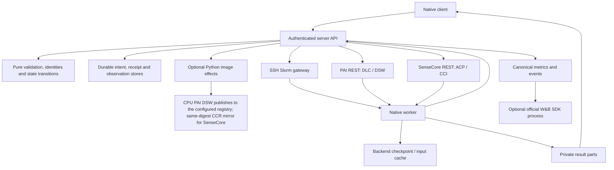

# Rust implementation and acceptance status

Default implementation: native Rust on `main`. Python reference baseline:
`e725faec689fb8395e692e27d00a8896fa7fe5a5` (1.5.1, tag `v1.5.1`). Production runs the
native service on Tokyo; Python API/builder services on Seoul are retired. See the
[latest release](https://github.com/NotDesigned/ml-experiment-control/releases/latest) for the current version. Direct HTTPS uses
`https://ml-exp.adscn.dev`; the old API domain and temporary port have been removed.
Historical metadata is attached read-only, with separate native write namespaces.
Slurm connects through the direct L40S-to-Tokyo gateway.

Run status and Submission GETs read retained evidence; they do not contact the
provider. The optional background observer and explicit `run reconcile` refresh
the original cloud job. A concurrent cloud observation may temporarily return
HTTP 503 `CLOUD_RUN_BUSY`: repeat the same query, without submitting another job.
Lock contention is not a frozen-identity failure. Scheduler observation times
remain unknown where the retained record has no timestamp; PAI image-pull events
are not yet included in the cached Run summary.

`GET /api/actions/policy` exposes native permission flags for older client
connection checks. It neither enables old Action mutation routes nor probes a
provider. The reported `training=INCOMPLETE` / `migration=IN_PROGRESS` describes
remaining acceptance and historical compatibility work, not an unfinished file
transfer: Slurm GPU training/restore and SenseCore GPU acceptance remain unproven,
and the full legacy metadata audit still has gaps. PAI CPU/H200 and W&B cloud
acceptance passed in bounded tests. These do not establish large-model or all-backend
acceptance. The older client's normal `check` can succeed; `check --training`
continues to fail closed.

“Connected” below means the CLI/API/service/worker code exists. It does not mean an
actual provider run has passed or that all historical Python state can be migrated.

## Architecture

Package ownership and module boundaries are in [architecture](architecture.md). The
core reads no environment, clock, files or network; effects return explicit receipts
to it. Image build/copy wrappers may remain Python, as permitted by the
complexity-first migration policy. W&B retains the official SDK process. Research
code may use Python/PyTorch or another image language.

## Connected workflows

| Workflow | Main implementation | Verification boundary |
| --- | --- | --- |
| Configure client, inspect status/logs/metrics, watch exact Attempt | `client/{config,session,watch,main}.rs` | Local HTTP and binary tests |
| Register approved Project; upload immutable source | `server/{projects,sources}`, `client/{projects,sources}.rs` | Private temporary stores and HTTP |
| Dockerfile prepare/build/reconcile/log/progress | `core/cloud/build.rs`, `server/cloud_runs/service/builds.rs`, `builds/native_image.py` | Frozen recipe and late-publication bridge tests; isolated DSW-to-Tokyo build passed |
| OCI-to-SIF on Slurm gateway | `worker/materialize.rs` | Exact reuse/capacity/tampering checks; real private ACR-to-SIF conversion passed |
| Upload/download cloud datasets | `server/objects.rs`, `service/datasets.rs`, `client/datasets.rs` | Bounded parts and immutable receipts; two-part OSS transfer/PAI CPU consumption and Slurm shared-storage upload/reuse passed |
| Import existing approved OSS datasets | `core/datasets/oss.rs`, `service/oss_import.rs`, `client/datasets.rs` | Scope-bound plain-tar inspection, immutable part reuse, no API-host spool; real OSS import and PAI CPU consumption passed |
| Download into CPFS / NAS input cache | `worker/{data_import,cloud_data}.rs` | Import/hash/cache tests; personal CPFS consumption passed; NAS provider acceptance pending |
| Frozen download script and verified persistent input cache | `core/data_preparation.rs`, `worker/data_preparation.rs`, `service/script_preparation.rs` | CPFS script execution and verified reuse passed; three-backend dispatch acceptance pending |
| CCR data image and CPU ACP copy before training | `service/data_delivery.rs`, `builds/native_data.py`, `worker/data_copy_cli.rs` | Stage control/hash/capability tests; actual copy pending |
| One experiment configuration | `core/preparation.rs`, `client/preparations.rs`, `service/preparations.rs` | Recovery slot, conflict, early preflight and HTTP tests |
| Matrix preparation and bounded dispatch | `core/preparation.rs`, `client/batch.rs` | Stable identities, exact terminal slot accounting; actual batch pending |
| Slurm / DLC / ACP submit, reconcile, refresh and cancel | `server/submissions`, `server/backends`, `server/cloud_runs` | Real bounded DLC CPU/H200 execution passed; Slurm GPU/ACP acceptance pending |
| Logs/history/checkpoints over gateway or scoped HTTPS | `io/observations.rs`, `worker/cloud_exchange.rs`, `service/exchange.rs` | Lost ACK, sequence, variant and frozen identity tests |
| Explicit new Attempt from selected persistent checkpoint | `core/cloud/retry.rs`, `service/retry.rs` | Immutable restore and budget checks; real PAI CPU and H200 split/continuous states matched independent oracles exactly |
| CPU result collection, direct download, verified ACK/release | `worker/cloud_artifacts.rs`, `service/artifacts.rs`, `client/artifacts.rs` | Real PAI zero-GPU synchronization, verified downloads, release and exact repeat passed |
| List and select result archive files | `client/artifacts/files.rs`, `io/artifacts.rs` | Selected-file persistence only after full archive verification; no partial ACK; direct original-file recovery still pending |
| DSW / CCI debug lifecycle | `core/cloud/debug.rs`, `service/debug.rs`, `client/debug.rs` | Actual zero-GPU DSW create/SSH/CPFS/stop/delete passed; CCI acceptance pending |
| Backend catalogue/cached capacity | `core/capacity.rs`, `service/capacity.rs`, `capacity_http.rs` | Local GET is effect-free; real PAI quota refresh and retained timestamp accepted; Slurm cached capacity refresh passed; SenseCore pending |
| Optional W&B publication | `core/tracking`, `server/tracking` | Fake SDK and durable ACK tests; same-Run official-cloud CPU acceptance passed; historical handoff attached, uncertain sends reserved pending remote proof |
| Scoped administrative maintenance and record retirement | `core/maintenance.rs`, `server/administration.rs`, `worker/maintenance.rs` | Confined plans and worker receipts; actual provider cleanup pending |
| Standalone verified client update | `core/distribution.rs`, `client/update.rs` | Public assets verified; public installer and update check passed on Tokyo |

Paths in the table are relative to `rust/crates`, except the two image bridge
paths under `server/src/ml_exp_server`. See [the native usage guide](../rust/README.md)
for commands and configuration shapes.

The build and SIF rows above and the historical sections below record tests that
published through Tokyo ACR. Builds now default to a CPU PAI DSW publishing to a
configured registry such as Docker Hub (see [builds](builds.md)); those records
are not acceptance of any other registry.

SenseCore can select the compatible cluster with the highest SPOT allowance from an
operator allowlist when creating a new Run; the profile is then frozen, and
reconcile, cancel and explicit retry never select a different pool. Training pools
exclude debug; data-copy profiles explicitly use debug CPU pools. Quota observations
do not establish the number of idle GPUs.

New DSW debug recipes use the v4 contract: at most 27 ASCII letters, digits and
underscores, with the personal CPFS mount at `/mnt/ml-expd-personal` (also DSW's
managed `/mnt/workspace`); the DLC mount contract stays separate. Issued v1/v2/v3
recipes keep their exact names, bodies and lookup identities, and an uncertain
creation is never replayed under a corrected recipe. A positively rejected HTTP 400
`ValidationError` on a new create is retained as a failed creation and does not
permanently consume an active-machine slot; transport failures and other uncertain
outcomes still require reconciliation. Errors retain only bounded, redacted provider
code, HTTP status, message and request ID. Debug status preserves the native provider
state: a failed instance reports `FAILED`, missing old observations report an unknown
terminal outcome rather than a successful stop, and queueing never advertises SSH as
ready. DSW stop sends an explicit empty JSON object, because its endpoint rejects an
empty body. Asynchronous deletion reports `DELETING` until provider absence is
confirmed. A retained `last_error` is historical evidence, not the latest state.

## Latest implementation completion pass

After changing the worker or its bridge, check the **installed** package with
the builder service's interpreter and environment. Updating a source checkout
does not update a wheel installed in another environment. Run
`tools/check_native_builder.py --config BUILDER_JSON --bridge-sha256 ACCEPTED_MODULE_SHA256
--worker-sha256 sha256:ACCEPTED_WORKER_SHA256 --require-feature shared-cache-identity.v2`
with that interpreter, without `PYTHONPATH` or `PYTHONHOME`. The check prints
the imported module path/hash and freezes the actual worker declaration in a
temporary local marker; it starts no provider job. Then exercise an actual
build through the running daemon and reconcile its receipt. A source-only
capability probe does not establish that the service loads the same code.

Bounded native PAI CPU execution, restore and results passed on Tokyo.
Three-backend training acceptance remains a separate pending check. Contracts from
this pass that still bound behavior:

- **Storage layout.** With a `storage-layout.v1` worker, fresh PAI/NAS workspaces need
  no manual Run or cache-parent directories; the mounted personal root must exist.
  Links, escaping paths and shared-writable descendants are refused without repair.
  Runtime receipts freeze the exact worker's capabilities, so older images and Run
  identities keep their original package and command contract.
- **Requests and credentials.** PAI CPU Runs pass the shared request shape; Slurm GPU
  validation is unchanged. Native credentials require service ownership and mode
  0600/0400, and configuration failures name the stage without exposing values.
- **Builder transport.** A proven pre-send failure permits another explicit execute of
  the same Runtime; a partial write, lost reply or older generic error stays uncertain
  and requires reconciliation. Missing and stale sockets, same-identity recovery and
  lost-reply refusal are exercised without provider effects.
- **Environment and discovery.** Per-Run `env` is frozen with the protocol across
  Slurm/DLC/ACP, and reserved platform variables are refused before effects. `data list`
  reads bounded local metadata only and separates uploaded archives from ready caches.
  Requests omitting these fields keep their old encoding.
- **Data preparation.** `data_preparation` freezes script path, interpreter, arguments,
  timeout and optional expected hash; source/image and user environment bind its cache
  identity, and the receipt records the script and every output file's SHA256. Slurm
  prepares on the networked gateway before submission, SenseCore uses the debug CPU ACP
  adapter, and PAI prepares inside the DLC job. Only complete verified caches are reused;
  failed/incomplete executions keep bounded diagnostics and are not silently replayed.
- **Filesystem publication.** The tested personal CPFS mount rejects
  `renameat2(RENAME_NOREPLACE)` (errno 22). Regular files use an atomic hard-link
  fallback that still refuses existing targets; dataset slots use exclusive directory
  allocation and publish the verified receipt last. General directory moves still
  require native no-replace support and can remain unavailable on such a filesystem.
- **Interrupted effects.** A saved build start marker without a live build requires
  reconciliation; it is not reported as EXECUTING and cannot be dispatched twice.
  SenseCore preparation distinguishes a running copy, terminal failure, completed copy
  and uncertain submission, and a failed copy returns `DATA_PREPARATION_FAILED` without
  authorizing GPU training. Slurm releases its helper metadata lock before running a
  download script; cancellation reaches the script, and failure retains diagnostics
  without publishing a PREPARED submission or replaying it.

## Storage and transfer contracts

- Dataset/result parts are 16 MiB, numbered from zero. Part count, metadata and
  storage budgets remain bounded; the old 4 GiB payload ceiling is removed.
- The API keeps source/control metadata and receipts. Cloud payloads stream to
  approved OSS parts; Slurm payloads go to the shared gateway. The API does not
  retain full dataset or weight archives.
- Recovery states stay on backend persistent storage. A complete ready marker,
  generation contents and hashes bind each registered checkpoint.
- Training completion, result publication, verification and release are distinct.
  Result ACK follows full client verification and local fsync. A lost ACK is
  reconciled with the same saved identity and file.
- Administrative deletion is a separate explicit plan. It cannot impersonate a
  verified download or cause a removed result to be collected again.
- PAI dataset loading uses signed object URLs and a verified personal CPFS cache.
  This does not enable the provider's previously blocked native OSS filesystem mount.

Metrics preserve arbitrary names and explicit units; protocol, checkpoint and
variant are identity fields. Scientific aggregation and model selection remain
research-code responsibilities. W&B display contract v3 keeps metric names across
Runs, with protocol and data identities in provenance; already-started publications
keep their v2 names and cursors, and upgrading does not rename or replay W&B history.
See [metric display](wandb.md#curves-and-chosen-results).

Cloud status normalizes the retained provider job ID, backend, native state and
queue reason into the shared client summary. Missing observation times remain
unknown. A new native Attempt manifest is not a local GPU process receipt;
unobserved native results are reported as not observed. Scheduler refresh releases
the global authorship lock before provider reads while retaining the Run fence
and serialized outbox commit, so a slow query does not block worker ingress.

## Deployment and release implementation

`ml-expd-rs --config /private/server.json` selects independent backend, tracking
and optional historical-reader files. `--check` and `--initialize` use the same file:
stores are created together only after dependency validation, existing/partial
registries are refused, and neither command submits provider jobs. Local checks never
start the W&B SDK or infer network readiness.

Native bundles contain four standalone executables, exact byte/SHA metadata, the
client installer and service/configuration examples. The release worker is static
musl for training images; server and client binaries keep the documented glibc
baseline. The release workflow tests the exact binaries before packaging. A manual
run produces artifacts only; a stable native tag enables public publication.

## Deliberate limits and remaining acceptance

The native registry uses a separate marker. Normal startup and GET never
initialize or repair it. Do not initialize over existing state. The production
cutover preserved historical identities and journals with read-only historical
metadata and separate native write roots. Unknown submissions and uncertain W&B
sends remain reserved; a successful connection check never authorizes replay.

Campaign authoring is intentionally absent; a Run does not need a research
question or Campaign. Batch commands perform explicit passes, not an unattended
queue. An expired authorization gate blocks dispatch until an explicit `run renew`
creates a fresh PREPARED plan; renewal is idempotent, preserves the Run/Attempt and
budget, and refuses any possible prior execution. No automatic checkpoint selection
or unbounded restart exists. Native debug supports CCI create/stop and DSW
create/stop/delete. Slurm dataset export is outside the OSS-specific dataset download
command.

An offline `ml-expd-state-audit` fingerprints existing manifests, checkpoint and
result receipts, source/runtime/preparation control receipts, tombstones, lifecycle
records, Action plans and SQLite rows, without initializing a native marker, copying
a database or reading scientific payloads. Equality is not production cutover
authority. Historical-state transformation and provider acceptance remain separate
work.

Historical reads reuse the ordinary read projections with mandatory kernel write
denial, no effect services, and all mutation/worker-ingress routes rejected. The
pinned reader can attach to a writable native service: one address routes reads by
exact Run ownership and reserves all historical IDs against new authorship, across
Slurm and cloud creation paths. Writable and original roots must be disjoint. A new
frozen Run can reference a historical checkpoint only when the native storage scope
and path convention match; old Actions never become native execution authority.
Reading a historical checkpoint does not authorize replaying its old Action or
restarting a job, and a native-created Run never falls back to this reader.

Historical result inventory GETs validate published receipts without reading
payloads or restoring a cache. Some early receipts contain only an archive hash:
absent per-file hashes remain `null`, with `checksums_complete=false` and
`payload_verified=false`. This compatibility applies only to historical reads; new
native publication and download acknowledgements still require complete file hashes.
The inventory covers the published archive, not uncollected files on a backend. A
hash-pinned original S3 profile can also issue a short-lived historical archive GET
URL; released archives return 410, and the ticket authorizes no ACK, cache restore or
deletion. Direct recovery of uncollected backend files remains separate work.

The W&B publisher compares its frozen config in Rust, permitting W&B's omission of
empty mapping fields while rejecting changed nonempty values, nulls, arrays and extra
keys. A failed comparison retains unconfirmed events and never replays training.

Next testing sequence: deterministic regressions → isolated client/server on CPU
DSW → actual storage/build/debug lifecycle → bounded training/restore/collection
on each enabled backend → historical-state migration and guarded production
cutover. This order predates the read-only production cutover above, which did not
transform historical state. Test failures keep their original evidence; missing or
ambiguous effects are reconciled under the original identity, never replayed with a
new token.

## Inventory and evidence

The Python baseline was 220 platform modules / 41,359 lines, plus 238
test/tool/example files. Baseline module parity and connected native
workflows are tracked separately. A zero count of fully accepted Python module
replacements is not an estimate of how much Rust code is written.

Local/DSW logs live in ignored `.ops` directories and are not release artifacts.
[The usage guide](../rust/README.md#build-and-verification) lists reproducible
format, lint, workspace-test, binary-smoke and bridge-test commands. Passing these
checks establishes development evidence, not real GPU or production acceptance.

## Historical Tokyo acceptance (2026-10-29 to 2026-10-30)

These tests preceded the production cutover. The native server and client ran in an
isolated deployment with a distinct token, registry, Project and service, behind a
temporary HTTPS entry removed on 2026-11-05; Python 1.5.1 and its scientific state
were untouched. Failures and test-runner errors remain in small private evidence
under `.ops/tokyo-native-20261029/`.

### CPU acceptance

The original executor permitted zero GPUs only.

- Source publication through the installed client and a DSW image build pushed to
  Tokyo ACR. Training pull credentials are configured separately from build push
  credentials.
- Import, repeat and download of a 17,838,080-byte OSS fixture in two immutable parts;
  a DLC worker verified and consumed its 17 MiB data file on personal CPFS.
- Continuous steps 1–8, a separate steps 1–4 execution, and an explicit new Attempt
  restoring steps 5–8, all with exit code 0. The restored state, RNG and cursor matched
  the continuous execution byte for byte: SHA256
  `ac780ffb06902ddcdbfc2c7b161a6c447d9fcebe3c23ba34116e7daec3527d61`.
- Metrics, logs and complete checkpoint receipts. Selected-file download sends no ACK;
  full verified download releases only its generated object parts; repeating it reuses
  the local archive and reconciles the same ACK.
- A separate zero-GPU synchronization job succeeded without repeating training.
- The exact public 0.1.0 binaries were hash-checked and installed. The published static
  worker built a fresh image and completed another eight-step DLC CPU Run whose final
  state matched. Selected download, full download, release and repeat passed again. The
  public client installer, update check and actual client update passed.
- The 0.1.3 candidate passed a zero-GPU DSW lifecycle: create, SSH key login, personal
  CPFS write/read/remove, native stop, native delete and background-confirmed
  disappearance, with absence separately confirmed through the provider API and no
  manual provider mutation. Initial naming, workspace mount and empty stop-body failures
  remain in the evidence; their original requests were never replayed.

Initial jobs without training registry credentials were stopped and positively
confirmed terminal. A client defect rejecting a zero-GPU reservation in a CPU retry
reply was fixed, then the same metadata-only retry was reconciled. An acknowledgement
collision with another operation retained the local archive; its exact retry succeeded.

### H200 CUDA and checkpoint acceptance

Three sequential PAI DLC jobs each requested at most one H200, four CPUs, eight GiB and
300 seconds, on a separate executor permitting at most one GPU. All exited zero, using
the published 0.1.3 static worker; 0.1.4 also passed read/verification regression
against these results.

- Continuous steps 1–8, partial steps 1–4, then explicit checkpoint restore 5–8.
- Actual NVIDIA H200 execution through CUDA driver/PTX. Final weights, RNG and data
  cursor match an independent CPU oracle exactly: SHA256
  `70e63aa69b4abd44173a1710d108a3c9cee2f9058b853b083943d85f73d5db87`.
- Both metric variants survive API ingestion: 16 continuous records and 8 per split
  Attempt. All records are valid and metric validation is complete.
- Verified result downloads, exact local reuse and ACK/release passed. Checkpoint steps
  8/4/8 remain readable after archive release. A concurrent ACK initially returned
  `CLOUD_RUN_BUSY`; repeating the same verified local download reconciled it without
  downloading or training again.

This is a tiny deterministic CUDA fixture, not PyTorch or large-model acceptance.

### Slurm gateway acceptance and remaining execution gap

A networked gateway received and verified a 17 MiB fixture through two parts; exact
repeat reused the same asset. It pulled the private Tokyo ACR image by its frozen
digest, converted it into a SIF, and published a hash-verified receipt retaining
`/ml-expd/source` as the source directory. Compute nodes need no internet for these
prepared files. Native 0.1.4 treats a `statvfs` report with no inode pool as unknown
rather than exhausted, and retains byte and known-inode guards. Private conversion also
needed explicit `--authfile`; conversion failures retain bounded, sanitized evidence.

The first Slurm training probe used a debug partition restricted to direct
`srun`/`salloc`, which rejected an independent `sbatch --test-only` diagnosis.
The original dispatch did not publish a job receipt and remains uncertain;
subsequent exact queue/accounting queries found no matching job. It was never
replayed or retroactively marked a confirmed rejection. A test-only check of
the ordinary H200 partition passed, but all eight GPUs were allocated at observation. Its
predicted job number/start time is not an actual allocation or reliable ETA.
Slurm GPU training, queue/cancel and checkpoint execution acceptance remain
pending; successful conversion/data delivery do not establish them.

SenseCore execution, official W&B cloud activity, PyTorch/large training,
historical-state cutover and direct original backend-file recovery remain
outside this acceptance. Dataset and weight payloads are not retained on the
API disk.
