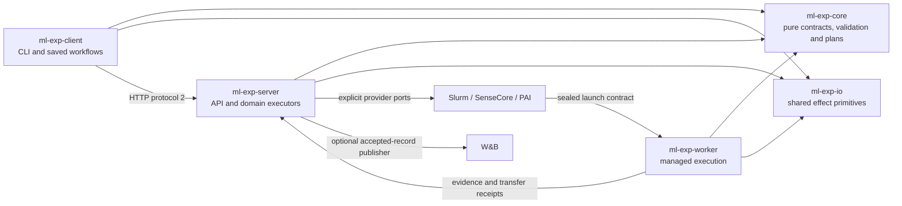

# Rust rewrite branch

`rewrite/rust` is an isolated development branch based on
`e725faec689fb8395e692e27d00a8896fa7fe5a5` (the deployed 1.5.1 source baseline).
The goal is a native Rust implementation of the platform: client, server,
provider integrations, builders, transfer helpers and workers. This is also an
opportunity to remove duplicate entry points and forwarding layers. The design
uses a functional core and a small imperative shell wherever practical.

**The rewrite is not complete, is not a replacement release and is not safe to
deploy over an existing workspace.** The Python implementation remains the
behavioral reference and the production implementation. No branch preview may
write production state, reuse provider mutation credentials, acknowledge a
research download or delete an existing asset.

User experiments are outside this language migration. A Run may still execute
Python, PyTorch, shell or any other code allowed by its image. The target is no
Python runtime dependency for platform binaries and their own helpers, not a
rewrite of users' training code.

## What exists now

| Component | Implemented foundation | Still missing |
| --- | --- | --- |
| Core | Python-compatible frozen JSON/digests, Run and launch manifests, generic metric schema/aggregation, Action/index reducers, Slurm command plans/parsers and observation projections | Remaining frozen contracts and complete cross-domain integration |
| Shared I/O | Private file reads, atomic writes, SHA256 streaming and Unix directory capabilities | Remaining transport primitives and durable domain protocols |
| Client | Private URL-bound connection settings, bounded JSON GET, preview `check/get/config` commands | Submit/upload/download/ACK, saved-state workflows, updates and full command coverage |
| Server | Loopback-only HTTP boundary; isolated legacy-compatible Action/RunIndex SQLite stores and permanent Run deletion fences | Experiment API composition, canonical journal, projects, scanners/collectors, provider executors, TLS and mutation APIs |
| Worker | Fresh-directory local subprocess execution, timeout/process-group supervision and result hashes | Sealed managed launch, data, checkpoint, journal, artifact, build, copy and deletion protocols |

Metrics now include schema/definition validation, typed and wide observations,
explicit units, required/conditional metrics, context-sensitive conflicts and
`ratio_of_sums`. Variant, protocol, checkpoint, dataset, step and epoch remain
separate. Non-finite observations retain diagnostics. These pure functions do
not yet replace the record ingress, journal, displayed metrics or W&B publisher.

Compatibility fixtures preserve the baseline source hashes and synthetic inputs.
Frozen JSON tests compare exact bytes and SHA256, including Python float formatting,
large integers and Unicode; observational projections also compare exact output
encoding. Action tests use a real legacy SQLite fixture, competing claims and
interrupted transactions. Slurm tests compare generated scripts and parse synthetic
scheduler evidence. None of these tests uses a live provider or production state.

The Action store keeps schema version 1 and immutable plan files. Pure reducers
take time, transition IDs and PID as input. Unknown submission outcomes remain
`RECONCILE_REQUIRED`; a retry plan requires exact, unambiguous evidence that no
job was submitted. Deletion guards never expire tombstones or delete assets.
Unix deletion storage retains directory descriptors rather than checking a path
and later reopening it. Intermediate symlinks, renamed/replaced parents and
non-regular lock targets are refused; new directory entries and immutable
tombstones are synced. Queries and index mutations share the deletion lock.
That directory-capability guarantee currently covers deletion storage. Action
plan/command paths and SQLite's path-based opens still need a common anchored
storage integration before exposing mutation APIs; final-component no-follow
checks alone are not protection against every concurrent parent replacement.

The disposable Run index preserves its legacy schema and unknown row metadata.
Pure change detection ignores only `scanned_at`, collector errors stay isolated
per verb, and evidence merging requires an exact Project/Run/Attempt. It is not
the complete outward `run_detail` or daemon-built failure assessment. Launch
validation similarly verifies the sealed manifest without fetching or executing it.

Several native policies deliberately reject unsafe legacy inputs: foreign or
duplicate Slurm identities, backwards terminal-state observations, malformed lock
targets and permission errors on deletion fences. Such validation changes are
recorded explicitly; they are not silent changes to old frozen identities.

No Rust module has been installed as a replacement for production. A passing
domain test is evidence for that tested domain, not acceptance of the entire
platform, an HTTP operation, or GPU training.

The preview commands are `ml-exp-rs`, `ml-expd-rs` and `ml-exp-worker-rs`.
They deliberately do not replace `ml-exp`, `ml-expd`, installed service units or
frozen worker image entries. See the [native development instructions](../rust/README.md).

## Five crates: functional core and imperative shell

| Crate | Owns | Must not own |
| --- | --- | --- |
| `ml-exp-core` | Immutable wire values, exact identities, validation, state reducers, metric schema, request planning and pure redaction | Files, network, environment reads, clocks, randomness, processes or scientific model selection |
| `ml-exp-io` | Shared bounded file/hash/atomic-write and effect primitives | Business state transitions, automatic retries or implicit provider policy |
| `ml-exp-client` | One command tree, connection/configuration, source packaging, resumable transfer, reviewed operations, observation and verified update | SSH/cloud credentials, a local scheduler or scientific completeness rules |
| `ml-exp-server` | Composition, HTTP, projects/sources, experiment/operation workflows, persistence, observation, data/build/result services, providers and optional tracking | Training computation or hidden replay of uncertain effects |
| `ml-exp-worker` | One native entry with explicit execution, prepare/copy, collection, build and scoped-deletion subcommands | Server modules, W&B credentials, arbitrary provider administration or implicit retries |

The existing `experiment-redact` is already Rust and remains the workspace's root
package. It is not a sixth new application layer. Its implementation should be
reused rather than replaced by another independent redaction policy.

Provider modules live together in the server, rather than being split between
an I/O-heavy core adapter and another server adapter. Each module implements the
ports it actually supports: scheduling, data/storage, resource observation and
optional debug sessions. A shared interface does not make unsupported operations
available. Slurm compute without Internet, SenseCore registry/NAS delivery and
PAI roles/CPFS remain different physical paths.

## Pure computation and explicit effects

Prefer pure functions for validation, state reduction, request planning,
compatibility checks, metric normalization and outward projections. Pass current
state, configuration, time, random identifiers and observed provider evidence as
explicit inputs. Return an immutable next state, a typed plan or `Result`; do not
read an environment variable or call a provider while deciding what should happen.

The imperative shell loads configuration, owns locks/leases, persists intents,
executes a reviewed plan and records the resulting evidence. Feed that evidence
back to pure reducers. Planning a submission must never submit it, and observing
a record must never repair an uncertain effect. File reads and hash streaming
belong to the I/O crate; hashing already-supplied bytes can remain pure.

Use ordinary functions, finite enums, structs and `Result`. Add a trait only at
a real replaceable boundary such as a provider or storage executor. One trait per
helper, deeply generic effect frameworks and extra thin forwarding modules would
make the rewrite harder to understand. Keep effect adapters small and test them
with real temporary files/processes or explicit transport fixtures as appropriate.

## Consolidation rules

- Keep one parser and one handler for each user operation. Existing public CLI
  names and saved states need explicit compatibility; private Python aliases,
  import facades and mixin forwarding do not need Rust equivalents.
- Compose services once. Merge `application`/`runtime`/controller facades where
  they only forward calls; keep a separate boundary where it owns authorization,
  persistence, admission, a subprocess or an external protocol.
- Use one reviewed mutation engine for prepare, authorize, execute and reconcile.
  Keep distinct typed effects and receipts for builds, data, submission,
  cancellation, collection and deletion. A common engine must not erase an
  effect's ownership, revision, confirmation or unknown-outcome rules.
- Keep one canonical record journal and one evidence reducer. W&B consumes
  accepted records; it is not another experiment database. Status, metrics,
  logs and progress reuse the same exact Run/Attempt binding.
- Keep one bounded transfer engine with destination adapters. Source, datasets,
  full recovery state and downloadable results retain separate identities and
  lifetimes. Sharing chunks does not imply identical deletion policy.
- Put historical `wyd` storage names, desktop asset locators, project-specific
  layouts and old controller invocation behind a named compatibility reader.
  New configuration uses generic Slurm and managed Runs. Do not create another
  provider branch for a historical name, or silently remove a still-supported
  read path.
- Python's public reusable-library API is a separate compatibility decision.
  A Rust crate cannot silently satisfy existing Python imports. Keep the old
  distribution until a documented consumer migration or approved bridge exists;
  a bridge is not completion of the all-Rust runtime goal.

## Inventory and progress accounting

The [machine-readable inventory](../rust/compatibility/inventory.json) records
all tracked Python files at the baseline, without scanning credentials or live
experiment state. Each platform module has its path, SHA256, line count, purpose,
top-level symbols, proposed target crate/domain and honest migration status.
The domain assignment is a consolidation plan, not a promise of one new Rust
file per old module.

| Baseline production package | Modules | Lines |
| --- | ---: | ---: |
| Core | 25 | 5,122 |
| Client | 21 | 3,712 |
| Server | 160 | 30,572 |
| Worker | 14 | 1,953 |
| Total | 220 | 41,359 |

The inventory separately covers 238 test/tool/example Python files, including
private builder/relay deployment helpers distributed as examples. Those helpers
must also lose their platform Python dependency before the goal is complete.
A scientific example payload may remain Python. Tests and packaging checks stay
until equivalent native acceptance exists; deleting them is not migration.

`partial_foundation` means a limited implementation exists with incomplete
contract acceptance. `not_started` means the target is only assigned. Neither
means production compatibility, and module counts are not a completion percentage.

## Migration sequence and acceptance

Every stage first passes isolated native tests, then differential checks against
synthetic Python-baseline fixtures. Capture canonical bytes/digests and actual
side effects; equal JSON shapes alone do not prove identity compatibility.
Do not use production scientific payloads for mutation tests.

| Stage | Required behavior and evidence |
| --- | --- |
| 1. Contracts and durable state | Frozen Run/Attempt/source/Runtime/asset identities; byte-compatible canonical hashes; schema/protocol values; Action SQLite transactions; atomic files, locks, revisions, journal recovery and workspace ownership |
| 2. Read-only client/API | Full protocol-2 auth/negotiation/errors, exact status/logs/metrics, freshness/provenance, queue blockers, SSE resync, private config and saved-state observation; no provider mutation from GET |
| 3. Local managed lifecycle | Sealed launch, bounded process trees/timeouts/cancellation, separate training/publication outcomes, generic metric schema/requirements/conflicts, journals and exact capability claims |
| 4. Images and input data | Dockerfile validation, native builder RPC/peer credentials, OCI/Docker/BuildKit, DSW builder cleanup, ACR fallback intent and late publication, digest-preserving CCR mirror, source sealing, bounded multipart and durable destination ACK |
| 5. Slurm | SSH staging/locking, `sinfo`/`squeue`/`sacct` parsing, exact submission comment, cancellation outbox, Apptainer conversion, gateway relay and offline compute, shared dataset/checkpoint paths and result recovery |
| 6. SenseCore | Native ACP/CCI REST auth, pagination and exact resource ownership, highest eligible SPOT allowance excluding debug for GPU training, debug CPU copy/collection, CCR/NAS readiness, delayed offline stderr/events, bounded CCI create/status/stop |
| 7. PAI | Signed DLC/DSW/quota requests, private role/personal CPFS scope, native queue blockers, tide/priority/resource policy, DLC 24-hour cap and DSW 4-hour cap, OSS dataset/archive flows; native OSS mounts remain disabled while provider-blocked |
| 8. Checkpoints and outputs | Complete-generation checks and scoped explicit restore; no automatic checkpoint choice; recover existing outputs without training; archive/file completeness, SHA validation, partial/lost-reply resume, ACK and retention, signed/direct downloads |
| 9. Tracking and administration | Native optional W&B publication, per-Run destinations, preparation switch, curves vs chosen summaries, variant/unit/protocol separation, remote ACK and session liveness; bounded debug leases, reviewed deletion/fences and source/project lifecycle |
| 10. Distribution and cutover | Full user command tree, verified update, server doctor/config, native binaries for supported platforms, offline installs, reproducible release manifest/SHA, systemd/builder/relay entries, real provider validation and guarded deployment |

Slurm, SenseCore and PAI require independent real acceptance: scheduling success
is not training success, and training success is not verified download. Each must
exercise data delivery, training metrics, complete checkpoint restore and result
retrieval, plus queue/failure/unknown-effect cases. Use separately authorized bounded
resources for billable provider tests. No real-provider acceptance is claimed
for the current preview.

## External compatibility checklist

The rewrite is not done until every applicable boundary below is represented in
fixtures and real integration evidence. An unavailable native dependency or
undocumented wire behavior is a blocker, not permission to invoke Python under
a Rust wrapper.

| Boundary | Required preservation |
| --- | --- |
| Public HTTP / SSE | Protocol 2, bearer and scoped callbacks, prefix/TLS behavior, advertised capabilities, routes/status codes/errors, async state, invalidations and bounded streams |
| Local state | JSON/YAML field semantics, immutable hash inputs, client state/dispatch markers, SQLite schema/journal and Action revisions, file modes, no-follow reads, locks/fsync and migration decisions |
| SSH / Slurm / Apptainer | Exact scheduler identity, shell/argv quoting, upload/receiver protocol, shared scope, OCI-to-SIF identity, private TLS relay and sanitized observations |
| SenseCore | ACP/CCI REST, cluster/workspace binding, registry authentication, job/event/offline logs, exact names, zero-GPU copy/collection and NAS receipt scope |
| Alibaba PAI | Signed OpenAPI and credential chain, DLC/DSW/quota APIs, MCP builder upload/exec, roles, mounts, shutdown timers and original configured limits |
| Object / registry / Docker | S3-compatible result storage, OSS multipart/ranged/signed requests, OCI Registry v2 auth/digests, Docker Engine/BuildKit, Unix peer identity and private builder RPC |
| Git / ACR / release | Exact private context/tag intent, no tag overwrite or unknown replay, registry publication observation, GitHub release metadata, asset SHA and standalone update/install formats |
| Worker | Launch manifest, environment/path contract, worker fingerprints, data/metrics/checkpoint/result/deletion receipts and exact-Attempt callbacks; old immutable workers remain distinguishable |
| W&B / telemetry | Native authenticated publish/remote confirmation, optional defaults and independent cursors, stable displayed keys and metadata, heartbeat; sanitized optional OTLP transport |
| Public library / distribution | Deliberate Python-consumer migration, native CLI/service entries, supported OS/architecture, offline installs and no hidden Python platform subprocess |

W&B currently relies on its official Python SDK in the baseline. Native publishing
and remote-confirmation semantics need dedicated work and real-cloud verification;
a logging call that merely enqueues data is not sufficient. The same applies to
Alibaba signing/MCP and SDK-mediated object-store behavior. Preserve the current
implementation as a reference until native replacements are accepted.

## Deployment boundary

This branch must not run against the live writable workspace or replace a
published package's bytes. Preview tests use temporary state and loopback-only
services. A future cutover needs a separately reviewed release, all domain gates,
identity-preservation proof, idle checks, a clearly bounded state migration and
formal installed-client/provider acceptance. Only then may public executable
names and production service entries switch to the native implementation.
