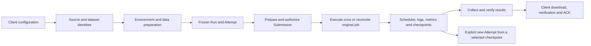

# Native ML-Expd

Development lives on `rewrite/rust`. Production remains the Python 1.5.1 service.
The workspace version is `0.1.0-dev.1`; `native-v0.1.0` has not been released.
Code implementation, automated verification, provider acceptance and production
cutover are separate milestones. See [the migration status](../docs/rust-rewrite.md).
Do not initialize this development binary over the production registry.

## Structure

| Package | Responsibility |
| --- | --- |
| `ml-exp-core` | Pure identities, validation, budgets, state transitions, reconciliation and request plans |
| `ml-exp-io` | Confined files, hashing, bounded child processes, archive/object transport |
| `ml-exp-client` | Private settings, preparation, submission, observation, transfers and maintenance CLI |
| `ml-exp-server` | Authenticated API, durable ledgers, backend adapters and background observation |
| `ml-exp-worker` | In-image execution, Slurm gateway/helper, data verification, checkpoint and result collection |
| `experiment-redact` | Existing shared credential redaction |

Core functions receive values and return decisions. Filesystem, network, clock,
randomness and subprocess effects belong to outer packages. A successful local
command is never sufficient proof that a scheduler accepted a job.

The optional image effect bridge stays in Python:
`server/src/ml_exp_server/builds/native_image.py` and `native_data.py`. Rust owns
its recipes, frozen Runtime identity and durable dispatch intent. W&B uses a
narrow optional official-SDK process. User training code can use any image language.

## Implemented workflows



- Slurm uses pinned SSH to an independently configured gateway. Data is verified
  on shared storage before submission. Compute nodes need no internet for
  datasets, metric ingestion or checkpoint registration.
- PAI uses REST for DLC training and DSW debug/build machines. Each new DLC Run
  can freeze `scheduling.allocation` (`guaranteed`, `allow_idle`, `idle_only`) and
  priority 1–9, default 5. The profile still enforces resource and duration limits.
- SenseCore uses REST for ACP training and CPU copy/collection, and CCI debug.
  Training and debug CPU profiles are separate; GPU ACP never uses a debug pool.
  An optional `spot_clusters` allowlist selects the compatible pool with the
  highest SPOT allowance, then freezes that profile per Run. Retry, cancellation
  and reconciliation keep this original choice. Quota is not idle GPU capacity.
- Cloud worker packets report process evidence, input progress, history pages
  and checkpoint metadata over a scoped HTTPS channel. Slurm collects equivalent
  evidence through its gateway. Missing evidence remains unknown.
- Result collection can run separately on CPU after training. The native cloud
  collector uses an existing digest-pinned worker image and persistent storage;
  it does not repeat the training command.
- Debug machines have bounded leases and retained create/stop identity. CCI
  supports create and stop; DSW also supports delete. Unknown creation is queried,
  never automatically repeated under a fresh identity.

## Client configuration

A native client does not require Python. Put the API token in a private file;
never paste it into a shell command or a repository.

```sh
ml-exp-rs --url https://api.example/ml-expd config set --token-file /private/api-token
ml-exp-rs check
ml-exp-rs backend
ml-exp-rs backend slurm-h100
ml-exp-rs backend slurm-h100 --refresh
```

The saved token is bound to the normalized API URL. An explicitly selected URL
cannot silently reuse credentials belonging to another server. `backend` lists
configured executors; capacity GETs read the cache only. An explicit refresh
queries the provider and retains the original time of the latest accepted data.
UNKNOWN and STALE observations do not promise availability or a start time.

## One experiment configuration

Register an approved Project, upload source, and upload or reference data first:

```sh
ml-exp-rs source import --help
ml-exp-rs data upload --project demo --executor pai-h200 --directory ./data
ml-exp-rs env list --project demo
ml-exp-rs run start --project demo --file experiment.json --state ./private-state.json
```

`experiment.json` uses this shape (replace the source and base image identities):

```json
{
  "request_id": "11111111111111111111111111111111",
  "runtime": {
    "source_id": "source.REPLACE_WITH_64_HEX",
    "executor": "pai-h200",
    "base_image": "registry.example/base@sha256:REPLACE_WITH_64_HEX",
    "dockerfile": "Dockerfile"
  },
  "run": {
    "run_id": "trial-001",
    "executor": "pai-h200",
    "command": ["python", "-u", "train.py"],
    "resources": {"gpus": 1, "cpus": 8, "memory_gb": 64},
    "walltime_seconds": 300,
    "seed": 42,
    "scheduling": {"allocation": "guaranteed", "priority": 5},
    "wandb": {"enabled": false},
    "artifacts": {"required_files": ["summary.json", "model.bin"]}
  },
  "approval": {"max_gpu_hours": 1, "reason": "bounded validation"}
}
```

For an existing Runtime, omit `runtime` and provide `run.runtime_id`. Inline
Runtime and explicit runtime_id are mutually exclusive. `scheduling` is a cloud
option; Slurm rejects it. SenseCore uses its own SPOT profile rather than PAI
idle allocation choices. Each request ID is a durable recovery slot; changing its
payload is a conflict. Budget and known provider limits are checked before build.

Preparation saves client recovery state before requesting any effect. Continue
using the returned preparation ID and confirmation:

```sh
ml-exp-rs run continue --help
```

Continuing builds/reconciles the environment, stages data and prepares a normal
Submission. It does not authorize GPU training. Use `run authorize` and
`run execute` with the returned Submission and confirmation. After response loss,
query that same preparation or Submission, then reconcile; do not invent another
identity. All command argument details are available through `--help`.

## Batches

A batch wraps one experiment configuration with a bounded Cartesian product:

```json
{
  "request_id": "22222222222222222222222222222222",
  "experiment": {"request_id": "11111111111111111111111111111111", "run": {}, "approval": {}},
  "parameters": {"lr": [0.001, 0.003], "wd": [0.0, 0.1]},
  "seeds": [42, 43]
}
```

Fill `experiment` with a valid configuration as above. At most 256 children can
be expanded. Child identities are deterministic and each has private saved state.

```sh
ml-exp-rs run batch --project demo --file batch.json --state-dir ./private-batch
ml-exp-rs run batch-continue --state-dir ./private-batch --confirmation 'PREPARE BATCH 22222222222222222222222222222222'
ml-exp-rs run batch-status --state-dir ./private-batch
ml-exp-rs run batch-submit --state-dir ./private-batch --max-active 2 --confirmation 'SUBMIT BATCH 22222222222222222222222222222222'
```

Continue and submit are explicit passes. Repeating a pass queries the saved
identities. Batch-submit authorizes only ready children and records a durable
claim before dispatch. Unknown submissions consume a slot and are never replayed.
The cap covers this batch, not other clients or the provider's entire quota.
An expired authorization gate can be replaced explicitly:

```sh
ml-exp-rs run renew action-0123456789abcdef --request-id 33333333333333333333333333333333 --confirmation 'RENEW action-0123456789abcdef'
```

The replacement remains PREPARED and needs fresh authorization. It retains the
Run, Attempt, scheduler token and budget; the old plan stays queryable. A possible
prior execution blocks renewal. Repeat the same request ID after a lost response.
Batch status follows the reviewed replacement; dispatch does not renew it
silently. The client does not run an unattended queue.

## Data, checkpoint and results

| Kind | Payload location | API responsibility |
| --- | --- | --- |
| Source | Immutable Project-scoped tree | Tree identity, bounded upload, receipt |
| Slurm dataset | Gateway shared storage | Fixed-size transfer to gateway, READY receipt |
| Cloud dataset | Approved private OSS prefix, then CPFS/NAS cache | Part identities, signed tickets, immutable metadata |
| Recovery checkpoint | Shared backend state directory | Complete-generation hash and restore source metadata |
| Cloud result | Private OSS parts | Publication verification, short-lived download tickets, ACK/release cursor |
| Slurm result | Generated backend archive | Bounded direct stream, verification, ACK/release |

Parts are 16 MiB and numbered from zero. The multipart protocol bounds each
buffer and part count; it does not impose the old 4 GiB archive limit. It still
has explicit metadata, part-count, provider and storage limits. Source packaging
has its own smaller source-only policy and is not a way to upload datasets.

PAI workers can download approved OSS objects through signed part URLs into their
personal CPFS cache. This native path does not activate provider OSS filesystem
mounts. SenseCore data goes through a CPU DSW-built data image, Tokyo ACR, a
same-digest CCR mirror and a debug CPU ACP copy into NAS. Download capabilities
stay outside Docker contexts. Training waits for a verified READY receipt.

`DATA_DIR` / `DATASETS_JSON`, `STATE_DIR`, `OUTPUT_DIR`, and `METRICS_PATH` are
separate contracts. Keep complete optimizer/RNG/cursor state under STATE_DIR.
Write a complete ready marker before registering a checkpoint. Restoring a new
Attempt explicitly references the exact checkpoint and storage scope; it does
not require uploading the full training state through the API.

Cloud datasets can also be downloaded with `data download`; the client verifies
the concatenated archive and every member and never overwrites an existing path.
A dataset download sends no result ACK and never deletes the dataset. Slurm
asset export is not provided by this object-only download command.

A result download verifies archive and member hashes, fsyncs the local file, then
sends an ACK. Repeating the same command can reconcile a lost ACK without another
download. Release removes generated transfer copies; it does not remove original
training outputs, persistent checkpoints or datasets. Explicit administrative
plans manage those separately and retain audit metadata. Interrupted object
release resumes its saved cursor. A deleted result cannot start another collector.

## Metrics and W&B

Training code writes arbitrary metric records to METRICS_PATH. Records include
name, numeric value, unit and optionally step/checkpoint/variant identity.
The Run freezes the evaluation context and optional required schema. No ELF
metric names, accuracy or perplexity are mandatory. Numerator and denominator
can preserve the original weighted aggregation. Detailed per-task data belongs
in JSONL/Parquet result files.

A step series and a final summary remain distinct in W&B. Unit, protocol,
checkpoint and variant remain part of metric identity. Publication uses a durable
cursor separate from canonical ingestion, so W&B failure cannot erase metrics.
Training sync is optional, normally enabled only when configured credentials and
a usable destination exist; preparation tracking is controlled independently.
Real official-cloud W&B acceptance is still pending for this native implementation.

## Existing-state audit

The offline audit accepts an explicit private read configuration without a native
workspace marker. Run it as the account that owns the original metadata:

```sh
umask 077
ml-expd-state-audit --config /private/original-reads.json --action-root /original/actions > /private/baseline.json
ml-expd-state-audit --config /private/candidate-reads.json --action-root /candidate/actions --compare /private/baseline.json
```

It reads Run/Attempt manifests, checkpoint receipts, result-transfer metadata,
source/runtime/preparation control receipts, deletion tombstones, lifecycle records and journal rows, including event IDs and
W&B publication cursors. Metrics retain their receive order and full scientific
context. It opens no logs, checkpoint payloads, source trees or result archives,
creates no workspace or database, and makes no provider request. Two complete
observations must agree; changing or over-budget evidence fails the audit.

Exit 0 means the requested observation has no reported issues (and a comparison
is equal); exit 2 means a mismatch or explicit issue; exit 1 means a complete
observation could not be obtained. Output contains identities and fingerprints,
not raw manifests, credentials or metric values. Equality covers this metadata
scope only; it does not authorize production replacement or scheduler execution.
This tool does not perform historical-state migration.

Database scans are bounded to 2,000,000 rows and 1 GiB of typed cell bytes;
control catalogues to 64 MiB, with at most 100,000 report entries. These are
streaming scan limits, not database copies or disk reservations. An inactive WAL
database without its required shared-memory index returns
`AUDIT_DATABASE_READ_ONLY_UNAVAILABLE`; the audit does not create auxiliary files
or switch journal mode. Schema, binding, busy and byte/row limits have separate
safe error codes. Historical missing fields are fingerprinted as absent; the
tool does not invent them or promote observations to execution authority.

The audit runs in a dedicated thread with kernel-enforced read-only filesystem
access (Linux Landlock ABI 3, normally Linux 6.2+). The caller retains its normal
permissions. If the restriction cannot be fully applied, it returns
`AUDIT_READ_ONLY_ISOLATION_UNAVAILABLE` before opening the state; there is no
weaker fallback. This also prevents a read-only SQLite connection from creating
an empty WAL file on a cold database.

The ordinary checkpoint GET routes support historical registered receipts even
when no native submission exists. `checkpoint-record-read.v1` advertises this
read capability separately from provider refresh/registration. The original
Run/Attempt source, image and issued storage context must match. Withdrawn or
deleted records stay unavailable. Neither GET nor this audit enables old
submission replay or rewrites checkpoint receipts.

## Build and verification

Use Rust 1.85 or newer. Build on an isolated machine when the API disk is small.

```sh
cargo fmt --manifest-path rust/Cargo.toml --all -- --check
cargo clippy --locked --manifest-path rust/Cargo.toml --workspace --all-targets -- -D warnings
cargo test --locked --manifest-path rust/Cargo.toml --workspace
cargo build --locked --manifest-path rust/Cargo.toml --workspace --bins
bash rust/tests/preview-smoke.sh
```

With the optional builder's Python dependencies installed, check its narrow
effect boundary separately. It uses temporary fixtures and makes no cloud calls:

```sh
PYTHONPATH=server/src:core/src:worker/src python3 rust/tests/test_native_build_bridge.py
```

Tests use temporary private namespaces, synthetic credentials and local fake
scheduler/container tools. They exercise real binaries, files, locks and sockets;
they do not establish that a real GPU, registry or provider storage works.
TLS terminates at an operator reverse proxy; the native daemon binds loopback.
Optional backend configuration is independent and credentials stay server-side.
The development registry has a distinct marker and cannot be initialized over
existing state. Retire only test-owned machines and scratch directories.
