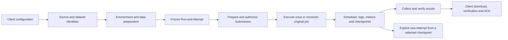

# Native ML-Expd

Development lives on `rewrite/rust`. Production remains the Python 1.5.1 service.
The workspace version is `0.1.4`, published separately from the Python service.
Code implementation, automated verification, provider acceptance and production
cutover are separate milestones. See [the migration status](../docs/rust-rewrite.md).
Do not initialize this binary over the production registry.

## Structure

| Package | Responsibility |
| --- | --- |
| `ml-exp-core` | Pure identities, validation, budgets, state transitions, reconciliation and request plans |
| `ml-exp-io` | Confined files, hashing, bounded child processes, archive/object transport |
| `ml-exp-client` | Private settings, preparation, submission, observation, transfers and maintenance CLI |
| `ml-exp-server` | Authenticated API, durable ledgers, backend adapters and background observation |
| `ml-exp-worker` | In-image execution, Slurm gateway/helper, data verification, checkpoint and result collection |
| `experiment-redact` | Existing shared credential redaction |

Core functions receive values and return decisions. Filesystem, network, clock,
randomness and subprocess effects belong to outer packages. A successful local
command is never sufficient proof that a scheduler accepted a job.

The optional image effect bridge stays in Python:
`server/src/ml_exp_server/builds/native_image.py` and `native_data.py`. Rust owns
its recipes, frozen Runtime identity and durable dispatch intent. W&B uses a
narrow optional official-SDK process. User training code can use any image language.

## Implemented workflows



- Slurm uses pinned SSH to an independently configured gateway. Data is verified
  on shared storage before submission. Compute nodes need no internet for
  datasets, metric ingestion or checkpoint registration.
- PAI uses REST for DLC training and DSW debug/build machines. Each new DLC Run
  can freeze `scheduling.allocation` (`guaranteed`, `allow_idle`, `idle_only`) and
  priority 1–9, default 5. The profile still enforces resource and duration limits.
- SenseCore uses REST for ACP training and CPU copy/collection, and CCI debug.
  Training and debug CPU profiles are separate; GPU ACP never uses a debug pool.
  An optional `spot_clusters` allowlist selects the compatible pool with the
  highest SPOT allowance, then freezes that profile per Run. Retry, cancellation
  and reconciliation keep this original choice. Quota is not idle GPU capacity.
- Cloud worker packets report process evidence, input progress, history pages
  and checkpoint metadata over a scoped HTTPS channel. Slurm collects equivalent
  evidence through its gateway. Missing evidence remains unknown.
- Result collection can run separately on CPU after training. The native cloud
  collector uses an existing digest-pinned worker image and persistent storage;
  it does not repeat the training command.
- Debug machines have bounded leases and retained create/stop identity. CCI
  supports create and stop; DSW also supports delete. Unknown creation is queried,
  never automatically repeated under a fresh identity.

## Client configuration

A native client does not require Python. Put the API token in a private file;
never paste it into a shell command or a repository.

```sh
ml-exp-rs --url https://api.example/ml-expd config set --token-file /private/api-token
ml-exp-rs check
ml-exp-rs backend
ml-exp-rs backend slurm-h100
ml-exp-rs backend slurm-h100 --refresh
```

The saved token is bound to the normalized API URL. An explicitly selected URL
cannot silently reuse credentials belonging to another server. `backend` lists
configured executors; capacity GETs read the cache only. An explicit refresh
queries the provider and retains the original time of the latest accepted data.
UNKNOWN and STALE observations do not promise availability or a start time.

## Temporary SSH machines

`ml-exp-rs debug list` shows the configured DSW or CCI profiles. Create a request
file using a profile from that list, a new 32-character hexadecimal request ID
and your actual SSH public key. The private key stays on your machine.

```json
{
  "profile": "pai-debug",
  "request_id": "REPLACE_WITH_32_HEX_CHARACTERS",
  "ssh_public_key": "ssh-ed25519 REPLACE_WITH_REAL_PUBLIC_KEY",
  "lease_seconds": 900,
  "gpus": 0,
  "cpus": 2,
  "memory_gb": 4
}
```

```sh
ml-exp-rs debug create --file ./debug.json
debug_identity='debug.REPLACE_WITH_RETURNED_IDENTITY'
ml-exp-rs debug refresh "$debug_identity"
ml-exp-rs debug show "$debug_identity"
ml-exp-rs debug stop "$debug_identity" --confirmation "STOP $debug_identity"
ml-exp-rs debug delete "$debug_identity" --confirmation "DELETE $debug_identity"
```

Only DSW supports delete; CCI supports create and stop. Refresh checks the
provider; show reads saved status. An SSH connection is returned only after the
provider reports Running. Use the returned host, port and user with the private
key corresponding to your submitted public key.

With background polling enabled, pending stops and deletes are reconciled
automatically. Asynchronous deletion stays `DELETING` until provider absence
is confirmed. Otherwise, use refresh to continue observing. Failed instances
report `FAILED`; a missing old observation cannot prove a successful stop.
`last_error` retains the last provider mutation error even after recovery;
`state` gives the latest established outcome. If a create reply is lost, inspect
list/refresh using the saved request identity instead of creating another machine.

## One experiment configuration

Register an approved Project, upload source, and upload or reference data first:

```sh
ml-exp-rs source import --help
ml-exp-rs data upload --project demo --executor pai-h200 --directory ./data
ml-exp-rs data list --project demo --executor pai-h200
ml-exp-rs env list --project demo
ml-exp-rs run start --project demo --file experiment.json --state ./private-state.json
```

`experiment.json` uses this shape (replace the source and base image identities):

```json
{
  "request_id": "11111111111111111111111111111111",
  "runtime": {
    "source_id": "source.REPLACE_WITH_64_HEX",
    "executor": "pai-h200",
    "base_image": "registry.example/base@sha256:REPLACE_WITH_64_HEX",
    "dockerfile": "Dockerfile"
  },
  "run": {
    "run_id": "trial-001",
    "executor": "pai-h200",
    "command": ["python", "-u", "train.py"],
    "resources": {"gpus": 1, "cpus": 8, "memory_gb": 64},
    "walltime_seconds": 300,
    "seed": 42,
    "env": {"OMP_NUM_THREADS": "4"},
    "scheduling": {"allocation": "guaranteed", "priority": 5},
    "wandb": {"enabled": false},
    "artifacts": {"required_files": ["summary.json", "model.bin"]}
  },
  "approval": {"max_gpu_hours": 1, "reason": "bounded validation"}
}
```

For an existing Runtime, omit `runtime` and provide `run.runtime_id`. Inline
Runtime and explicit runtime_id are mutually exclusive. `scheduling` is a cloud
option; Slurm rejects it. SenseCore uses its own SPOT profile rather than PAI
idle allocation choices. Each request ID is a durable recovery slot; changing its
payload is a conflict. Budget and known provider limits are checked before build.

`run.env` contains per-experiment string values and participates in the frozen
Run and protocol identity. Platform directory, identity, GPU-runtime, resume and
`ML_EXPD_` variables are reserved. Credentials belong in private server/provider
configuration, not in this mapping. Omitting it preserves the original encoding.
`data list` is a metadata read: `UPLOADING` means incomplete transfer, `ARCHIVED`
means the uploaded bytes are verified, and `READY` means a backend cache receipt
exists. Workers still verify input files before training.

An optional download script can replace uploading a dataset:

```json
{
  "data_preparation": {
    "script": "remote/fetch_data.py",
    "interpreter": "python3",
    "arguments": ["--split", "train"],
    "timeout_seconds": 1200
  }
}
```

Put this field inside `run`; the script must be part of its source image.
It writes into `DATA_DIR` and must exit successfully before training starts.
The platform records the actual script hash, parameters and all produced file
hashes. `expected_content_sha256` can pin the canonical digest of the sorted
`[{"path": ..., "bytes": ..., "sha256": ...}]` inventory. Cache reuse verifies
every file. A failed/incomplete script is retained for diagnosis and is not
automatically rerun. Change the explicit source/arguments to request a new cache.

On Slurm the operator enables `script_preparation` for the backend and configures
the gateway helper's absolute `data_preparer` path to Apptainer. The gateway
executes this CPU preparation before `sbatch`, so training nodes need no Internet.
SenseCore uses its configured debug CPU ACP data copier. PAI executes preparation
inside the allocated DLC job and counts this time toward the job's time limit.
It uses the approved persistent mount; an absent mount is never created locally.
New script-enabled cloud Runs require an image worker declaring
`script-preparation.v1`; old frozen images keep their original capabilities.
For SenseCore, preparation status retains the CPU job's identity and distinguishes
failure from uncertainty and ordinary waiting. A failed copy reports
`DATA_PREPARATION_FAILED` without creating a training Submission. Direct
`run prepare` can return `operation=PREPARE_INPUT` while the CPU job is pending;
that response cannot be used with `authorize` or `execute`.
Slurm download scripts receive cancellation and run without holding the helper's
global metadata lock; a failed/cancelled preparation leaves no dispatchable plan.

Preparation saves client recovery state before requesting any effect. Continue
using the returned preparation ID and confirmation:

```sh
ml-exp-rs run continue --help
```

Continuing builds/reconciles the environment, stages data and prepares a normal
Submission. It does not authorize GPU training. Use `run authorize` and
`run execute` with the returned Submission and confirmation. After response loss,
query that same preparation or Submission, then reconcile; do not invent another
identity. All command argument details are available through `--help`.

## Batches

A batch wraps one experiment configuration with a bounded Cartesian product:

```json
{
  "request_id": "22222222222222222222222222222222",
  "experiment": {"request_id": "11111111111111111111111111111111", "run": {}, "approval": {}},
  "parameters": {"lr": [0.001, 0.003], "wd": [0.0, 0.1]},
  "seeds": [42, 43]
}
```

Fill `experiment` with a valid configuration as above. At most 256 children can
be expanded. Child identities are deterministic and each has private saved state.

```sh
ml-exp-rs run batch --project demo --file batch.json --state-dir ./private-batch
ml-exp-rs run batch-continue --state-dir ./private-batch --confirmation 'PREPARE BATCH 22222222222222222222222222222222'
ml-exp-rs run batch-status --state-dir ./private-batch
ml-exp-rs run batch-submit --state-dir ./private-batch --max-active 2 --confirmation 'SUBMIT BATCH 22222222222222222222222222222222'
```

Continue and submit are explicit passes. Repeating a pass queries the saved
identities. Batch-submit authorizes only ready children and records a durable
claim before dispatch. Unknown submissions consume a slot and are never replayed.
The cap covers this batch, not other clients or the provider's entire quota.
An expired authorization gate can be replaced explicitly:

```sh
ml-exp-rs run renew action-0123456789abcdef --request-id 33333333333333333333333333333333 --confirmation 'RENEW action-0123456789abcdef'
```

The replacement remains PREPARED and needs fresh authorization. It retains the
Run, Attempt, scheduler token and budget; the old plan stays queryable. A possible
prior execution blocks renewal. Repeat the same request ID after a lost response.
Batch status follows the reviewed replacement; dispatch does not renew it
silently. The client does not run an unattended queue.

## Data, checkpoint and results

| Kind | Payload location | API responsibility |
| --- | --- | --- |
| Source | Immutable Project-scoped tree | Tree identity, bounded upload, receipt |
| Slurm dataset | Gateway shared storage | Fixed-size transfer to gateway, READY receipt |
| Cloud dataset | Approved private OSS prefix, then CPFS/NAS cache | Part identities, signed tickets, immutable metadata |
| Recovery checkpoint | Shared backend state directory | Complete-generation hash and restore source metadata |
| Cloud result | Private OSS parts | Publication verification, short-lived download tickets, ACK/release cursor |
| Slurm result | Generated backend archive | Bounded direct stream, verification, ACK/release |

Parts are 16 MiB and numbered from zero. The multipart protocol bounds each
buffer and part count; it does not impose the old 4 GiB archive limit. It still
has explicit metadata, part-count, provider and storage limits. Source packaging
has its own smaller source-only policy and is not a way to upload datasets.

PAI workers can download approved OSS objects through signed part URLs into their
personal CPFS cache. This native path does not activate provider OSS filesystem
mounts. SenseCore data goes through a CPU DSW-built data image, Tokyo ACR, a
same-digest CCR mirror and a debug CPU ACP copy into NAS. Download capabilities
stay outside Docker contexts. Training waits for a verified READY receipt.

`DATA_DIR` / `DATASETS_JSON`, `STATE_DIR`, `OUTPUT_DIR`, and `METRICS_PATH` are
separate contracts. Keep complete optimizer/RNG/cursor state under STATE_DIR.
Write a complete ready marker before registering a checkpoint. Restoring a new
Attempt explicitly references the exact checkpoint and storage scope; it does
not require uploading the full training state through the API.

Cloud datasets can also be downloaded with `data download`; the client verifies
the concatenated archive and every member and never overwrites an existing path.
A dataset download sends no result ACK and never deletes the dataset. Slurm
asset export is not provided by this object-only download command.

`data import-oss` can import an existing **plain tar with regular-file entries**
from the configured bucket. Input keys are restricted to the configured user's
`users/<user>/datasets/` prefix or `public/datasets/`. The request supplies
`--object-key`, `--sha256` and `--archive-bytes`; no bucket URL or credentials
come from the client. The server discovers and verifies the complete inventory,
then copies through fixed 16 MiB buffers into its immutable dataset parts.
Original objects are never modified or deleted. Repeat the same request after
a lost reply; a changed object cannot overwrite previously acknowledged parts.
This command requires a cloud executor with configured object storage. It does
not directly mount OSS and does not materialize a backend cache by itself.

```sh
ml-exp-rs data import-oss --project demo --executor pai-h200 \
  --object-key users/alice/datasets/train.tar \
  --sha256 REPLACE_WITH_64_HEX --archive-bytes 17827328
ml-exp-rs run files action-REPLACE_WITH_16_HEX
ml-exp-rs run file action-REPLACE_WITH_16_HEX --path summary.json --output ./summary.json
```

`run files` lists a verified result archive's inventory. `run file` reads and
verifies the archive but retains only the selected file locally. It sends no ACK
and authorizes no release. Repeating it verifies an existing destination instead
of overwriting it. This implementation still transfers the entire archive; it
does not yet replace direct recovery of original backend files when archive
publication failed. That recovery path remains a separate migration requirement.

A result download verifies archive and member hashes, fsyncs the local file, then
sends an ACK. Repeating the same command can reconcile a lost ACK without another
download. Release removes generated transfer copies; it does not remove original
training outputs, persistent checkpoints or datasets. Explicit administrative
plans manage those separately and retain audit metadata. Interrupted object
release resumes its saved cursor. A deleted result cannot start another collector.

## Metrics and W&B

Training code writes arbitrary metric records to METRICS_PATH. Records include
name, numeric value, unit and optionally step/checkpoint/variant identity.
The Run freezes the evaluation context and optional required schema. No ELF
metric names, accuracy or perplexity are mandatory. Numerator and denominator
can preserve the original weighted aggregation. Detailed per-task data belongs
in JSONL/Parquet result files.

A step series and a final summary remain distinct in W&B. Unit, protocol,
checkpoint and variant remain part of metric identity. Publication uses a durable
cursor separate from canonical ingestion, so W&B failure cannot erase metrics.
Training sync is optional, normally enabled only when configured credentials and
a usable destination exist; preparation tracking is controlled independently.
Real official-cloud W&B acceptance is still pending for this native implementation.

## Deploying a native service

Linux x86_64 binaries (including WSL2) are packaged independently of Python.
The server/client release target requires glibc 2.34 or newer. Release workers
are statically linked with musl so a newer build machine does not make them
depend on a newer glibc in the training image. The installer requires
Bash, curl and GNU coreutils; it checks exact release hashes and binary version
before replacing the client. It installs no service and reads no API key.

```sh
bash install-native.sh --version 0.1.4 --prefix "$HOME/.local/bin"
ml-exp-rs update --version 0.1.4 --check
```

These commands use the published
[`native-v0.1.4` release](https://github.com/NotDesigned/ml-experiment-control/releases/tag/native-v0.1.4).
Existing Python release assets are separate. Native backend and migration
acceptance limits are described in the [implementation status](../docs/rust-rewrite.md).

Server bundles contain the server, client, worker and metadata-audit executables,
a hash manifest and [deployment examples](deploy/server.example.json). Put private
configuration under `/etc/ml-expd/native/`; token and provider credentials stay
in separate files. A single deployment file refers to approved read, Slurm,
cloud and optional tracking configurations. Omitted backends stay disabled.

For private DLC images, set `registry_auth_file` on the PAI backend itself,
as shown in the PAI example. A builder's registry login authorizes its pushes;
the training transport needs its own reference to the approved pull credentials.
These credentials are injected only into the provider request and never frozen
in a Run, image build context or public status response.

```sh
ml-expd-rs --config /etc/ml-expd/native/server.json
```

Copy [the Project example](deploy/project.example.json) to the configured
Project path and create its empty Run directory. Run these commands as the
service account that will own the stores:

```sh
ml-expd-rs --config /etc/ml-expd/native/server.json --check
ml-expd-rs --config /etc/ml-expd/native/server.json --initialize
ml-expd-rs --config /etc/ml-expd/native/server.json
```

`--check` reads local configuration, credentials and approved Project definitions.
It sends no provider request, starts no SDK and initializes no store. Its
`provider_connectivity_checked=false` is deliberate: passing configuration
validation does not establish a working remote connection. `--initialize`
creates all stores selected by this one configuration, with no provider jobs.
It refuses an existing or partially initialized registry. It never repairs,
resets or deletes one. The granular initialization commands in `--help` remain
available for an operator to inspect and finish partial setup. Ordinary startup
does not initialize missing stores.

Select only the backends needed for this installation:

| Backend | Deployment reference | Credentials and storage |
| --- | --- | --- |
| SSH Slurm | `submission_config`: [Slurm example](deploy/slurm.example.json) | Pinned SSH config/known_hosts; helper and data helper on the networked gateway; shared Run/data roots |
| PAI DLC | `cloud_config`: [PAI example](deploy/pai.example.json) | Private PAI access key file, approved quota/CPFS/user role, exact private registry auth, personal OSS prefix |
| SenseCore ACP | `cloud_config`: [SenseCore example](deploy/sensecore.example.json) | Private SenseCore access key file, training pool and personal NAS; separate debug CPU copier/collector |

All IDs, hashes, resource limits, storage paths and accounts in these examples
are placeholders. Replace them with approved values. Backend `enabled`,
`allow_run_creation` and polling start disabled. The examples must not be used
as proof of available resources. To configure PAI and SenseCore together, put
both definitions in the same cloud file's `backends` list; its exchange and
object store are shared. Executor IDs must be unique across Slurm and cloud.
PAI/SenseCore profiles also require matching credential `provider` values.

Credential files have these shapes; enter actual values privately, never in a
Project, source archive, experiment file or command argument:

```json
{"provider":"pai","access_key_id":"REPLACE","access_key_secret":"REPLACE"}
```

SenseCore uses `"provider":"sensecore"`. PAI may additionally specify
`security_token` for temporary credentials. The OSS file uses
`access_key_id`, `access_key_secret` and optional `security_token`, without
`provider`. The exchange signing key is a separate private file of at least
32 random bytes. Its public URL must reach this API over HTTPS from workers.
Native credential files must be owned by the service account with mode `0600`
(or `0400`). Group-readable credentials from an existing Python deployment need
a separate private native copy; do not change the live deployment's originals.
Configuration preflight identifies provider credentials, registry auth, exchange,
object storage, debug and builder configuration failures separately.

Image builds use their own explicitly configured builder socket, native worker
SHA256 and source namespace. Slurm may also use an existing trusted Runtime
receipt, or the cloud builder's `slurm` materializer map to produce its SIF.
New materialization receipts retain the image's source directory; launch plans
use that directory rather than assuming `/workspace`. Private pulls pass the
configured Docker authentication file explicitly to Apptainer. A failed
conversion retains bounded, sanitized process evidence in `build_error`.
Unreported inode counts remain unknown; known byte or inode shortages still
block the operation. A successful preflight does not reserve disk space.
PAI also accepts `resources.gpus: 0` for bounded CPU Runs through the same
preparation, authorization, metric, checkpoint and result flow. Slurm GPU profiles
retain their positive-GPU rule. CPU Runs still require a finite positive approval
ceiling and walltime; their GPU reservation is zero.

New images freeze the exact worker's declared features in their Runtime receipt.
A worker declaring `storage-layout.v1` can create its own private Run directories
and dataset-cache parents beneath the already mounted personal CPFS/NAS root.
It never creates the mount, changes its permissions or adopts an unmarked cache.
CPU data-copy jobs use the same plan. Old Runs and images keep their original
requirements; they never gain new command parameters implicitly.

The worker executable must run on the chosen image's Linux/libc version.
Slurm gateway helper configuration must use exactly the same `target` as its
server profile; initialize the helper/data stores once on the gateway. Neither
copying these examples nor enabling an executor installs remote helpers.
Choose a partition accepting `sbatch`; some debug partitions allow only direct
`srun`/`salloc`. A later parameter check cannot retroactively prove the outcome
of an earlier uncertain submission, which must retain its original identity.

The [systemd example](deploy/ml-expd-native.service) installs no unit by itself.
Adjust its approved writable and read-only paths to the actual configuration.
When attaching history, expose original paths read-only; allow writes only to
the new native roots. Do not initialize a native marker over an original registry.
Image building may use the separately configured Python effect adapter; its
interpreter/dependencies are outside this native bundle. W&B similarly uses the
optional official SDK process. Neither is required for basic API/client reads.

The tag workflow builds/checks native executables and creates `SHA256SUMS`,
`native-release.json`, individual binaries and a server bundle. A manual workflow
run only packages; publishing requires an exact stable `native-vX.Y.Z` tag.
Neither path restarts production. Production cutover still needs provider and
historical-state acceptance plus the existing idle and identity checks.

## Existing-state audit

The daemon also has an explicit historical reader. It serves the existing
Project, Run, Attempt, log, metric, collection-status and checkpoint GETs directly
from the original namespace. It starts no provider observer, SDK publisher or
initializer, and rejects all mutation routes, including worker ingress.

Generate a pinned configuration from the same private original-read settings
used by the audit, then run a separate loopback reader:

```sh
umask 077
ml-expd-rs --inspect-historical-config /private/original-reads.json > /private/historical-reader.json
ml-expd-rs --historical-read-config /private/historical-reader.json --token-file /private/reader-token --bind 127.0.0.1:18766
```

The generated configuration pins the original journal workspace ID or its
absence. The original flat Project lifecycle ledger and deletion fences must
already exist. Each historical observation runs in a dedicated thread with
kernel-enforced write denial; an unsupported kernel is an error. Paused or
archived Projects stay hidden, and a different journal or native marker is
refused. No historical SQLite file is copied or migrated.

A writable native service can attach that same pinned reader with
`--history-config /private/historical-reader.json` and its ordinary
`--read-config /private/native-reads.json`. The registry and Run roots must be
disjoint. Queries, metrics, tracking cursors and checkpoint GETs then use one
address. Project counters combine both sources. Existing or deleted historical
Run IDs remain reserved, including in asynchronous preparations; duplicate or
corrupt native identities cannot fall back to history. Old Actions are never
converted into native execution authority.

A new Run may explicitly reference a historical checkpoint. The native planner
still checks the exact Project, complete checkpoint, storage scope and configured
backend path convention; incompatible storage is rejected. The worker validates
the checkpoint files before training. This is a new frozen Run, not a replay or
an automatic restart of the old task. Historical W&B routes and cursors are read
without republishing or resetting them.

The offline audit accepts an explicit private read configuration without a native
workspace marker. Run it as the account that owns the original metadata:

```sh
umask 077
ml-expd-state-audit --config /private/original-reads.json --action-root /original/actions > /private/baseline.json
ml-expd-state-audit --config /private/candidate-reads.json --action-root /candidate/actions --compare /private/baseline.json
```

It reads Run/Attempt manifests, checkpoint receipts, result-transfer metadata,
source/runtime/preparation control receipts, deletion tombstones, lifecycle records and journal rows, including event IDs and
W&B publication cursors. Metrics retain their receive order and full scientific
context. It opens no logs, checkpoint payloads, source trees or result archives,
creates no workspace or database, and makes no provider request. Two complete
observations must agree; changing or over-budget evidence fails the audit.

Exit 0 means the requested observation has no reported issues (and a comparison
is equal); exit 2 means a mismatch or explicit issue; exit 1 means a complete
observation could not be obtained. Output contains identities and fingerprints,
not raw manifests, credentials or metric values. Equality covers this metadata
scope only; it does not authorize production replacement or scheduler execution.
This tool does not perform historical-state migration.

Database scans are bounded to 2,000,000 rows and 1 GiB of typed cell bytes;
control catalogues to 64 MiB, with at most 100,000 report entries. These are
streaming scan limits, not database copies or disk reservations. An inactive WAL
database without its required shared-memory index returns
`AUDIT_DATABASE_READ_ONLY_UNAVAILABLE`; the audit does not create auxiliary files
or switch journal mode. Schema, binding, busy and byte/row limits have separate
safe error codes. Historical missing fields are fingerprinted as absent; the
tool does not invent them or promote observations to execution authority.

The audit runs in a dedicated thread with kernel-enforced read-only filesystem
access (Linux Landlock ABI 3, normally Linux 6.2+). The caller retains its normal
permissions. If the restriction cannot be fully applied, it returns
`AUDIT_READ_ONLY_ISOLATION_UNAVAILABLE` before opening the state; there is no
weaker fallback. This also prevents a read-only SQLite connection from creating
an empty WAL file on a cold database.

The ordinary checkpoint GET routes support historical registered receipts even
when no native submission exists. `checkpoint-record-read.v1` advertises this
read capability separately from provider refresh/registration. The original
Run/Attempt source, image and issued storage context must match. Withdrawn or
deleted records stay unavailable. Neither GET nor this audit enables old
submission replay or rewrites checkpoint receipts.

## Build and verification

Use Rust 1.85 or newer. Build on an isolated machine when the API disk is small.

```sh
cargo fmt --manifest-path rust/Cargo.toml --all -- --check
cargo clippy --locked --manifest-path rust/Cargo.toml --workspace --all-targets -- -D warnings
cargo test --locked --manifest-path rust/Cargo.toml --workspace
cargo build --locked --manifest-path rust/Cargo.toml --workspace --bins
bash rust/tests/preview-smoke.sh
```

With the optional builder's Python dependencies installed, check its narrow
effect boundary separately. It uses temporary fixtures and makes no cloud calls:

```sh
PYTHONPATH=server/src:core/src:worker/src python3 rust/tests/test_native_build_bridge.py
```

Tests use temporary private namespaces, synthetic credentials and local fake
scheduler/container tools. They exercise real binaries, files, locks and sockets;
they do not establish that a real GPU, registry or provider storage works.
TLS terminates at an operator reverse proxy; the native daemon binds loopback.
Optional backend configuration is independent and credentials stay server-side.
The development registry has a distinct marker and cannot be initialized over
existing state. Retire only test-owned machines and scratch directories.
